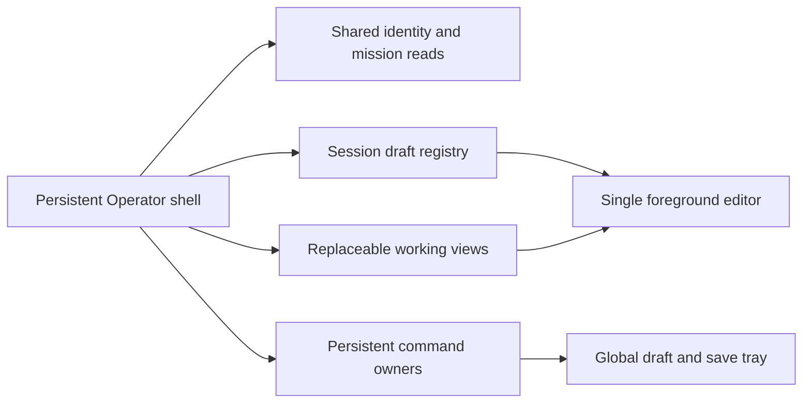

# Operator design revision 2

Design approval remains pending. This revision responds to the
[PR review](https://github.com/bcl1713/starlink-dashboard/pull/382#issuecomment-6252762425).
It replaces the first preview's priority/layout proposals where they differ. The
original [parity matrix](audit.md) remains a required implementation and
acceptance checklist, with no removal of capabilities. No product implementation
or implementation plan is included.

Open [the revised preview](review-v2.html) for stress Operations,
Communications, Transport, Issues, mission selection, source failure, and
keyboard scenarios. The same five synthetic connected intervals, next call,
overdue call, conferences and three advisories feed all three concepts. Use the
A/B/C links to compare spatial organization with identical data; no backend is
connected.

## 1. Priority and overflow contract

The stress scenario is 14:22 UTC: five reported connected customer intervals on
two established bridges, an additional preparing bridge, a delayed requirement
past 14:15, Echo's next call at 14:35 with preparation at 14:25, three
concurrent modeled advisories and two issue follow-ups. Timing for one connected
interval is unknown. Conference state never supplies a missing customer report.

| Surface                | Always visible                                                                                                                                                                                        | Bounded detail and overflow                                                                                                                                                                                                                                            |
| ---------------------- | ----------------------------------------------------------------------------------------------------------------------------------------------------------------------------------------------------- | ---------------------------------------------------------------------------------------------------------------------------------------------------------------------------------------------------------------------------------------------------------------------- |
| Desktop awareness rail | Reported-connected total, next FUTURE requirement and preparation time, source/as-of state                                                                                                            | First three connected intervals ordered by reported join then stable identity (unknown joins last); `All 5 customers` opens the complete list, with connected count and Next still pinned. Counts explicitly show incomplete/unknown if record coverage is incomplete. |
| Desktop Operations     | Next preparation and its nearest transport advisory together; overdue call separately labeled; modeled risk count and earliest boundary; direct nearby Reschedule, Join/reuse, Record applied, Update | Central time list shows the next three events; `All events` exposes the complete feed. Attention shows two items plus `All attention` if needed. Lists scroll within their region; pinning consumes a bounded header, never an unbounded list.                         |
| Portrait Operations    | Compact `5 reported connected / All customers` and named next call/prep; source/as-of line; earliest advisory plus `All 3 advisories`                                                                 | Customer names move to the expanded customer list/Comms, never five stacked cards before Next. Next/risk pair precedes overdue/issues. Additional advisories and attention retain counts and 44px expansion controls.                                                  |
| Landscape Operations   | Compact awareness strip across the top; named next requirement/prep; connected and risk counts                                                                                                        | Two work columns use the remaining height. No tall left list displaces Next. In an editor the strip compresses to one row, while a full customer list is an explicit contextual destination.                                                                           |
| Every view/editor      | Named future requirement, prep time or explicit unknown, connected count with stale/incomplete label, transaction/draft indicator                                                                     | New urgent occurrence appears in a reserved awareness slot (desktop text, short mobile text plus count). It does not expand a modal, resort the focused editor, or move focus. Event details open only on operator action.                                             |

Overdue is not next. If there is no timed future requirement, say that
explicitly and keep untimed requirements accessible; do not substitute the
earliest overdue item. Urgent advisories are never reduced to an unlabeled
total: show the earliest relevant boundary and its kind/basis, plus a
count/expand control for the rest. None of those advisories alone implies an
observed outage. An interrupted or closed conference with customers still
reported connected raises a continuity discrepancy; it does not silently remove
customers from the count.

One action sends an existing lifecycle command (Establish, Verify, Join, Leave,
Interrupt, Restore connection, Monitor, Resolve, Reopen). Commands are named by
target and show pending/receipt state in that row and the persistent tray. A
full editor is justified for a new requirement, reschedule parameters, transport
report, substantive issue update, observation, or retrospective correction. No
acknowledgment/reason gate is introduced for ordinary actions or estimates.

## 2. Lifecycle walkthroughs

### Busy Communications

1. Bridge C is Preparing. `Establish Bridge C` reports establishment;
   `Verify Bridge C` reports the operator's test/verification. There is no new
   instrumented “Test passed” command: existing
   `conferenceCommand(..., 'verify', ...)` records `verified_at` only. It is not
   customer connectivity or routing verification.
2. Bridge A stays Established across Alpha, Bravo and Charlie.
   `Customer joined Bridge A` creates the existing unknown participation
   interval immediately; customer/call identity can be corrected in details.
   Joining never completes another call or closes another interval.
3. `Customer left Alpha` ends only Alpha's interval. The walkthrough shows
   Bridge A still Established and the other customers still Reported connected.
4. `Interrupt Bravo` preserves that interval; `Restore Bravo connection` creates
   a NEW linked interval using `resumeCommand`. The prior gap remains in
   History. Restore record (tombstone) remains a separate secondary action.
5. `Reschedule Echo` opens UTC/shift controls with duration unknown. Save
   changes the requirement, not bridge or participation state. The
   preparing/established conference can be reused for the next call without
   closing it.

The preview mutates only synthetic in-page state and labels results “Preview”.
It demonstrates control placement and state separation, not API execution.

### Busy Transport

1. From the next-call/risk pair or persistent quick action choose
   `Record applied`. The editor defaults to Reported Applied, with service and
   applied transport. Timing is explicitly Unknown until supplied; no
   Requested/Checked prerequisite.
2. The adjacent context identifies five reported connected customers, their
   reported configuration, next prep, a PoP advisory and an X restriction using
   backend-supplied `live_route_eta` basis. Select all advisories for remaining
   risk context. Do not calculate new restriction times in the browser.
3. `Save applied report` stays enabled with valid inputs even during an active
   call/advisory overlap. The inline amber warning has no acceptance checkbox.
   An empty required service produces input validation; that is distinct from a
   nonblocking advisory. Unknown report time is valid.
4. For another service use Add service; Intended/Requested/Operator Checked and
   precision/relationships stay independent, disclosed options. Correcting an
   existing application clears its previous check unless explicitly replaced. A
   later move creates a new decision; it does not overwrite the last move.

### Issues and correction

Issues shows Monitor, Resolve, Reopen according to saved status, plus a separate
Mitigation value (`none_reported`, `mitigated`, `workaround`, `unknown`).
Mitigation does not resolve the issue. Update/follow-up opens the normal editor.
Resolve clears the current follow-up; Reopen keeps it cleared. Activity →
Correct message opens the selected historical text/effective time, keeps the
current issue status/follow-up, and retains the original in immutable History.
Operational activity and immutable revisions are visibly distinct destinations.

## 3. Mobile keyboard and live updates

The keyboard previews explicitly reserve synthetic browser chrome and keyboard
regions within 390×844 and 844×390. They are constrained-layout simulations, not
evidence of real iOS/Android keyboard behavior. The runner also focuses an
input, injects an urgent event/customer change, and verifies focus and typed
content survive. Device browser acceptance remains required after
implementation.

| Constraint                                       | Visible controls and behavior                                                                                                                                                                                                                                                                         |
| ------------------------------------------------ | ----------------------------------------------------------------------------------------------------------------------------------------------------------------------------------------------------------------------------------------------------------------------------------------------------- |
| Portrait, 48px browser chrome + 300px keyboard   | Compact editor title; one Now/Next row; short urgent slot; scrolling fields; fixed 44px-or-larger Save and Keep draft actions above the keyboard. General navigation and global action dock are removed from this editor mode.                                                                        |
| Landscape, 28px chrome + 140px keyboard          | One-line named Next/prep plus connected count, compact urgent slot integrated into the awareness region; scrolling field viewport; 44px Save/Keep draft row. Only one or two fields fit at once; do not pretend the long form fits. Scroll to validation/focused field without moving keyboard focus. |
| Long customer/service names                      | Named next item uses a bounded two-line or shortened label plus `Details`; full label remains in accessible name and editor. Buttons wrap text internally and keep their target dimensions; the primary time is never truncated.                                                                      |
| Unknown report/actual times                      | Explicit Unknown; neither now nor an exact value is silently inserted. User chooses UTC date/time and precision when known.                                                                                                                                                                           |
| Invalid service/time                             | Inline field error linked with `aria-describedby`, invalid input identified; Save attempt focuses the first invalid field. Current/Next and draft survive. Warning text cannot cover footer or masquerade as successful save.                                                                         |
| Customer or urgent advisory changes while typing | Reserved awareness text/count updates; polite live announcement with coalescing; no focus movement or field replacement. Acknowledge changes only a supported alert occurrence and never submits the report.                                                                                          |
| Return to another work view                      | `Keep draft` exits the editor without sending; a persistent `Drafts / saves` tray resumes the target. No editor state is owned by the view being replaced.                                                                                                                                            |

The design avoids nested sticky footers by making the editor a flex layout with
one scrolling field region and a non-scrolling footer. Production uses the
visual viewport height/offset where available, safe-area insets and normal
resize fallback; it must test focus scrolling and avoid treating an orientation
change as a new draft. Reduced viewport can constrain field space but must not
hide Next, the pending indicator or both Save and Keep draft.

## 4. Command and draft ownership decision

This is the proposed architecture to approve, not a claim about current code.
The current generic notes/calls/conference/participation unsent drafts are React
state. Only issue/capability/transport callers enable `durable: true` pending
storage; `useOperatorJournal` defaults to false. Existing pending replay and
unsent draft persistence are different mechanisms. Universal recovery therefore
requires explicit frontend work; unchanged backend contracts do not provide it.

The shell is mounted at the Operator route level above working views and mission
selection. It owns the editor and registries; changing tabs never unmounts their
owners. Cross-page navigation restores session drafts on return. Without a
receipt, transport writes are never automatically retried merely because a view
mounts. Background completion can update the named transaction tray; it cannot
replace an unrelated active editor.

Each draft envelope contains a schema version, stable draft ID and immutable
target tuple:
`(store_id, api_epoch, source_mode, simulation_run_id, mission_id, record_type, record_id-or-new-id, scope, leg_id, previous_leg_id, next_leg_id, correction-target-version-or-null)`.
It also stores base record/version, current input and last local persistence
result. Session storage is tab-local, preserving the current privacy/lifetime
boundary; it does not promise recovery after closing the tab, cross-device sync
or offline server acceptance. Changed target/scope is an explicit editor
operation with relationship validation, never a byproduct of choosing a
different mission. Unresolved IDs are retained without inventing links.

Multiple unsent drafts are allowed, one foreground editor at a time. A distinct
new-draft ID prevents two new calls overwriting each other. `Keep draft` parks
the current editor; selecting another action parks it first and opens/resumes
that target. The tray shows type, readable mission/leg/record name,
unsent/pending/ conflict/quarantined state and Resume/Review. Discard is
explicit. The active editor is not evicted to impose a hidden draft-count limit;
storage exhaustion shows failure and retains the in-memory envelope. If
persistence fails, block destructive navigation until the user deliberately
keeps the page or discards that unsent content; successful persistence does not
need a confirmation.

Before submit, store a separate frozen command envelope with full body,
operation, key, epoch, identity, target/base version and source draft ID.
Persist first, then dispatch. Serialize writes per existing
`(identity, mission, record type)` owner; other drafts can be prepared while it
is pending. Do not queue automatic disconnected writes. Store-unavailable Save
is disabled, drafts remain editable. One pending command cannot be replaced by
another draft. Existing hooks need adapting/hoisting, not duplicate mounted
instances for every row.

| Command state                                | Persistent tray and editor behavior                                                                                                                    |
| -------------------------------------------- | ------------------------------------------------------------------------------------------------------------------------------------------------------ |
| Unsent                                       | Session draft retained; no backend acceptance claimed; edit/park/resume                                                                                |
| In flight                                    | Named saving target; freeze submitted input; another editor/view can open without resetting request                                                    |
| Outcome uncertain                            | Explicit exact retry reuses bytes/key/time/epoch; no fresh now, inferred success or duplicate command                                                  |
| Receipt accepted, current reread unavailable | Show `Accepted · current state unavailable`; retain target for reread, prevent stale record edits; do not retry an accepted command as a new write     |
| Receipt + current row available              | Retire only the submitted draft revision; later unsent changes remain separate; update views without replacing their drafts                            |
| Version conflict                             | Keep local input and base version; show saved latest alongside draft; explicit review/reconcile then new command/key, never blind retry                |
| Store identity changed                       | Quarantine old command/draft; no replay into new store; explicit reread/reconcile; copying as a new entry requires deliberate target choice            |
| Session data invalid/unavailable             | Visible failure, keep in-memory draft if available; no claim of reload recovery; do not silently replace unreadable pending state with a fresh command |

Mission selection parks work under its original target. The global tray remains
visible across selected missions. A pending Meridian/Leg 2 save remains labeled
Meridian/Leg 2 when browsing another mission; late receipts never switch the
selected mission or reopen that editor. Store-health changes apply to write
availability independently of last-known event read state.

## 5. Mission, record scope and freshness

The chooser uses existing paginated `missionsApi.listPage`/`useMissionsPage`,
then mission detail (`useMission`/`missionsApi.get`) and leg names/`is_active`.
Search filters loaded pages with an explicit remaining-pages action; no invented
global search endpoint. Mission selection does not activate a leg. Show active
flight context only when existing telemetry/event source identity aligns with
the selected mission and leg. `is_active` alone is a selection flag, not
observed airborne phase. Otherwise say Active leg selected / Flight phase
unknown.

The chooser preview separates `Active flight: Meridian / Leg 2 · Airborne` from
`Record target: Meridian / Between legs · Leg 1 → Leg 2`. The latter is an
explicit record association. Mission, preflight, leg, between-leg and postflight
options are readable selectors; selecting a different scope exposes the required
leg or previous/next leg choices. A draft's target does not follow live phase
changes. Leg activation and itinerary edits stay in Missions.

Source state is a concise persistent line: `Events 14:22 · Live ETA · partial`
with Details for source capture/alignment. In preflight show `Planned UTC`;
after airborne aligned backend data arrives show `Live route ETA`. During
transition without a usable live source show `Live ETA unavailable`; scheduled
boundaries can appear only as explicitly planned reference in detail, never as
live alerts. The preview provides separate Planned, Live and Unavailable states
to compare. Real timing remains `production_live_timing.py` /
`production_pop_events.py`.

If the local store is down while a prior event snapshot exists, retain
`Last known 14:22 · store unavailable` and `5 reported connected at 14:22`, not
zero or an all-clear. No valid prior snapshot means unknown counts. The write
owner blocks Save; keep drafts and read-only context. An optional predictor
failure alone does not block a healthy store's operator reports. A PoP window is
advisory and transport configuration/intent never establishes actual routing.

## 6. Same-data visual alternatives

Concept A pins awareness and next/risk context with task views. Concept B makes
the event queue primary and places persistent bridge/customer entities in a
separate shelf. Concept C groups customers and call requirements under bridges,
with an untimed/unassigned lane and risk/issue utility region. Its rows do not
draw invented call durations. Desktop and portrait stress screenshots for each
use exactly the shared fixture and preserve future prep separately from overdue.
Compare them in the revised preview before approving an architecture.

## 7. Acceptance additions and review disposition

The future implementation plan must measure normal AND high-workload journeys:
find next call, log unexpected call, reschedule, customer join/leave while the
conference remains established, applied-only move during a protected call,
update/resolve/reopen/mitigate and historical-message correction, observation,
selected-window recenter, prior decision retrieval, and customer PDF extraction
/ single-ZIP clean-instance plan import. Capture elapsed time, interactions,
mis-selection and error recovery against the same baseline fixture. Preserve the
original feature matrix as individually checkable/tested entries.

Preview checks prove local design interactions and constrained layout only.
Actual keyboard/assistive technology, source/phase transitions, persistence,
conflict/receipt handling and the full production narrative still require real
integration acceptance. Explicit approval is requested only after reviewing this
revision's layouts and ownership decision. Concept A remains recommended; the
review's support for A is not final visual approval.
