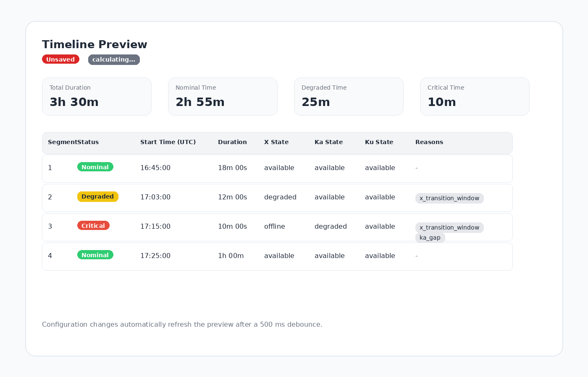
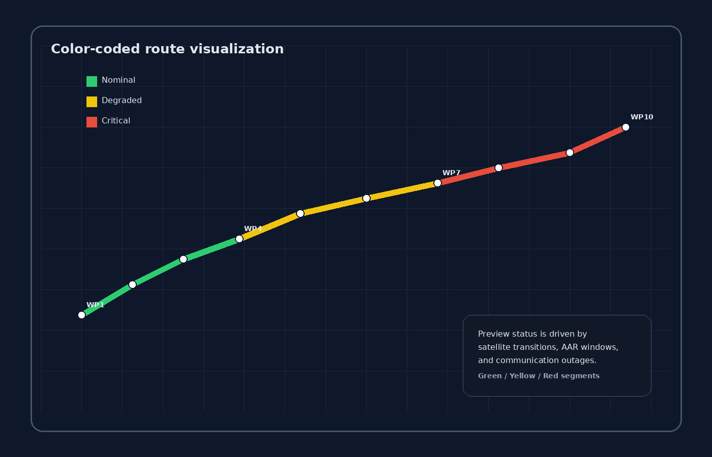

# Mission Communication Planning

This guide describes current `dev`. Automatic itinerary creation/revisions and
route SIGMET attention/live crossing timing were added after v1.0.0; see
[release notes](../release-notes.md).

Pre-flight communication degradation prediction for satellite transports.

## Mission Planning Features

### Mission Planning Interface

Create and manage missions with transport configurations.

**Features:**

- Define mission routes with waypoints
- Configure satellite transports (X-Band, Ka, Ku/StarShield)
- Set timing windows and operational constraints
  - All times use 24-hour format (HH:mm) for aviation/maritime consistency
  - Times are entered and displayed in UTC timezone
- Specify azimuth angle thresholds for degradation
- Mission timeline visualization
- Real-time timeline preview with automatic updates when configuration changes
- Unsaved-state indicator so you know when the preview is ahead of the saved leg
- Color-coded route overlay for nominal, degraded, and critical segments

**Transports Supported:**

- X-Band (primary command & control)
- Ka-Band (high-bandwidth data)
- Ku-Band/StarShield (Starlink connectivity)

**See:** [Mission Planning Guide](../missions/mission-planning-guide.md)

### Real-Time Timeline Preview

The preview recalculates automatically after a short debounce whenever you edit
satellite transitions, outages, AAR windows, or manual AR tracks. A manual AR
track is projected onto the planned route: its earliest and latest projected
points bound an X-Band degraded interval. The manual track remains an orange
dashed geographic overlay; it does not replace or redraw the planned route. You
can make a change, watch the route and status colors update, and only save once
the result looks sane. The preview panel shows an Unsaved badge whenever the
current configuration differs from the persisted leg.

What the preview tells you:

- Green segments mean nominal communication coverage
- Yellow segments mean degraded communication
- Red segments mean critical communication gaps
- The timeline table lists segment status, UTC timing, duration, transport
  state, and reason codes
- Route map overlays update immediately so transition impacts are easy to spot
- The preview uses the same calculation engine as the saved leg, so what you see
  is the same model the API stores

How to use it well:

1. Make one configuration change at a time when you are trying to understand a
   color change.
2. Use the table to read the reason codes, then cross-check the map to see where
   the risk sits on the route.
3. Keep experimenting while the Unsaved badge is present; save only when the
   preview matches the mission intent.
4. For long routes, expect the table to stay usable by rendering only the
   visible rows.

### Satellite Geometry Engine

Analyzes 3D satellite positions and communication viability.

**Capabilities:**

- Real-time azimuth angle calculation
- Elevation constraint checking
- Multi-satellite tracking
- Degradation window prediction
- Communication status (nominal/degraded/lost)

**Output:**

- Timeline of degradation windows by flight phase
- Affected transports per window
- Duration and severity estimates
- Crew briefing summaries

### Multi-Format Exports

Generate mission briefing documents in multiple formats.

**Export Formats:**

- **PDF:** Crew briefing with charts and timelines
- **CSV:** Log format for post-flight analysis
- **XLSX:** Excel format with multiple sheets

**Contents:**

- Mission summary and timing
- Transport configuration
- Degradation window details
- Satellite geometry data
- Recommendations and notes

Use the mission export dialog to prepare and download a snapshot package. See
[export preparation and contents](../missions/planning/outputs.md).

**See:** [Mission Communication SOP](../missions/mission-comm-sop.md)

### Mission Planner Visualization

Use Mission Planner at <http://localhost:5173> for mission and leg planning,
timeline views, and the native Overview.

**See:** [Overview features](overview.md)

## Create or update from an itinerary

Choose **Create from itinerary** on Missions, select the text-bearing PDF and
all route KMLs, then choose **Generate mission**. The server extracts the legs,
associates routes and AR windows, and generates an X-band plan using the
configured satellite list. A completed import opens the ordinary mission page;
legs remain inactive until explicitly activated. There is no separate access
confirmation, proposal application or publication workflow.

KML timestamps retain seconds. PDF times are matched at minute precision with
one minute of tolerance. Larger differences can still match when route
endpoints, dates and occurrence evidence identify one assignment. AR entry is
derived from the PDF's takeoff-to-entry offset; AR exit uses its exit-to-landing
offset on the KML timeline. Ambiguous route or AR associations appear as
targeted corrections. Missing or contradictory evidence is not silently replaced
with guessed values.

Use the normal leg editor to adjust takeoff, edit transports or update a route.
Updating an active route requires deactivation. A route-bound AR or handover
must be uniquely associated with the new geometry before replacement can
complete.

Choose **Update from itinerary** on an imported mission, supply a new PDF, KMLs,
or both, and select **Update mission**. Omitted sources are reused where valid.
Changes apply automatically without a JSON review or extra approval. The mission
keeps its name and ID, compatible manual edits survive, and uploaded changes
take precedence on conflicting fields. Prior revisions and source documents
remain in the mission package. Legs appear in chronological departure order in
the mission and exported briefing.

Imports continue on the server when the dialog closes. Reopening it in the same
browser resumes the saved operation. Upload limits are 10 MiB for the PDF and 16
KMLs totaling 40 MiB. Operations have a 20-minute overall deadline and bounded
worker execution. Existing itinerary missions are converted on server startup,
preserving accepted legs and unfinished source records for revision recovery.

## Starshield PoP transition advisories

With Starshield enabled, the planner automatically shows outlined transition
windows and city-to-city UTC details. Each window is the estimated geographic
crossing time minus five minutes through plus five minutes. Every transition
remains visible. Its full window counts as a planned communications outage only
where Starshield is the sole usable call transport. Available Ka or X prevents
that transition outage. X blocked only by Starshield concurrency is a planned
fallback; an independent AR, geometry, manual or other constraint disqualifies
it. The projection splits at capability changes and unions overlapping outages.
Planning totals and posture reflect this call-continuity assessment. Measured
transport availability and the normal Starshield preference remain unchanged; no
service switches or X activation happen automatically.

Overview distinguishes the observed public-IP city from the geographic forecast.
An early observation of the expected destination completes that occurrence; a
late observation keeps its advisory active. An unexpected known city warns that
a transition can happen at any time. A failed lookup after an IP change leaves
the current observation unknown. An unchanged public IP retains its cached city.
Completion clears that occurrence's remaining transition outage without changing
saved mission totals or fixed windows. A late advisory may outlast its window,
but does not extend the planned outage. Unknown transport capability remains
unresolved. Ordinary dynamic live forecasts currently lack aligned capability
evidence, so their call continuity is unresolved; prepared mission replay uses
captured capabilities on the mission clock.

Simulation selects the nearest configured PoP from current aircraft position,
including without an activated route. Each catalog identity has a stable
simulation-only documentation IP. Replay uses the mission clock; changing speed
or resetting recomputes the observation from position. Synthetic observations do
not establish operational Starshield behavior or inject an outage.

The configured catalog seeds Los Angeles, Ashburn, Dallas, Sydney, Frankfurt and
Tokyo, using city centers. Its fingerprint participates in forecasts and export
preparation identity. Update the supported catalog configuration to maintain
entries. A catalog editor, discovery management UI, automatic catalog updates,
window calibration and real IP-range matching are deferred.
