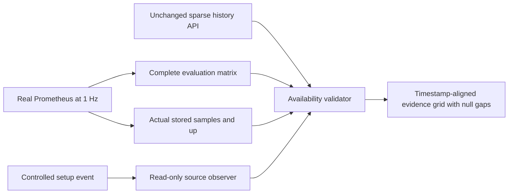

# Availability-aware acceptance contract v2

Approved for #391 after the
[availability investigation](perf-391-availability-review.md). This is
acceptance policy, not an application SLO. Production application code and
history APIs are unchanged.

## Version and isolation

`tools/acceptance/performance_availability/` is a separate harness, with
contract version `perf390-availability-v2`. Preserve the original #390 harness
at `13cbf1d54b526307747578ecd4fc691562846834`, its detached measurement
worktree, and all original evidence. The existing strict harness in `dev` at
`33b60fa8` also remains byte-identical. V2 forks its resource-owning
runner/browser and fixtures, and reuses unchanged comparison, polling and
cleanup helpers. The existing stronger resource/latency comparison guards remain
required.

Every run records application SHA, harness source SHA, harness file hashes,
contract version, image identities, dependencies, hardware, browser, workload,
instrumentation and cleanup. Comparisons require identical harness source,
contract, file hashes and workloads; strict/v2 cohorts cannot be combined.
Instrumentation-off and counter runs remain separate. A short validation pair is
not a performance result or substitute for three matched repetitions.

## Data flow



The evidence grid is an analysis artifact. It is never written back as telemetry
or returned by the production API.

## Setup and measurement boundaries

Record each setup operation's ID, kind, phase, start, successful completion and
recovered observation. Only activation/configuration/deactivation events are
eligible; history-window settings are recorded by the existing request flow and
do not independently excuse a telemetry gap. Setup exception events must recover
before the explicit wall-clock measurement boundary. Warmup and measured timing
are retained separately from setup.

Poll the acceptance-only state endpoint during a controlled operation, then
check recovery against its successful completion. Stop readiness polling after
two seconds. Record sampled publication status, source identity and acquisition
time, acquisition age and per-field availability. Publication-ready alone is
insufficient. The candidate adapter captures one immutable head under existing
source admission and records its retained successful-publication time separately
from acquisition time. It checks coordinator lifecycle, active route, published
route fingerprint and replay identity against authoritative in-memory inputs. No
filesystem read or source update is performed by the adapter. Older baselines
explicitly report `legacy-untracked`; they have no equivalent frame diagnostic,
and the harness must not manufacture one.

The steady synthetic workload expects the existing 11 observation fields from a
simulation source. A source must have a fresh accepted acquisition (at most the
existing ten-second freshness boundary), correct provenance, and all fields
required by that source contract. Recovery validation accepts explicit
field-specific contracts: replay can have finite position and unavailable
network measurements; first live speed can remain unobserved. Unrequired fields
are recorded truthfully, not converted to finite values. The standard
performance runner continues to use its synthetic simulation fixture; this does
not claim physical live-device qualification.

## Grid, projection and setup exception

For the 30-minute workload require exactly 1,801 evaluation coordinates,
`start + i`, inclusive bounds and `step_seconds=1`, across all 11 expected
metric families. Values do not determine whether a timestamp exists.

Fetch the complete raw Prometheus evaluation matrix at the API's exact bounds.
Fetch an instant range vector separately for actual stored sample timestamps.
For every API field, require exact equality to the finite-only projection of
that raw evaluation matrix. The production API may omit NaNs; the evidence grid
keeps their original coordinate as `null`. Shifted/duplicate timestamps,
ambiguous or missing raw series, missing raw evaluations, infinities, arbitrary
API deletions, and fabricated finite values fail with distinct diagnostics.

An unavailable evaluation is eligible only when its underlying actual stored NaN
falls inside a documented controlled event's interval. That event must have
recovered within two seconds of successful operation completion. Permit at most
three evaluation slots per affected series for setup, and at most three in total
per series across setup events. Steady 30-minute histories require at least
99.8% finite coverage. Preserve every exception's metric, evaluation time,
actual sample time and event ID. A past setup gap can remain inside a rolling
window; it does not excuse a new measured gap.

Missing scrapes are never NaN exceptions. Actual samples must support the raw
evaluation values; a successful `up` scrape must include each of the 11
families, even when a value is explicitly NaN.

## Measured steady state and source checks

Steady measurements permit no new unexplained unavailable observations, pending
or failed source publications, provenance changes or stalled source clocks.
Record the existing browser request/polling/error gates unchanged. Serialize
periodic and transition source captures so HTTP completion order cannot invert
source order. Recovery requests use their remaining two-second deadline. The
additional owned host observer samples source publication at 1 Hz; it records
its capture wall and thread CPU overhead in both instrumentation cohorts. It
runs only while the acceptance runner owns it, and is drained before browser
cleanup.

Verify actual Prometheus `up` timestamps and values over the measured interval,
not merely finite resampled history. Validate every stored value across the
entire measured interval, including samples older than the final 30-minute
history. Take overlapping API/raw history checkpoints every 15 minutes and at
completion; require their time coverage to span the whole measurement. Thus an
early soak NaN cannot age out unnoticed.

Require successful scrapes, approximately one-second actual intervals (0.75–1.25
seconds to allow scheduler jitter), edge coverage within 1.25 seconds, and at
least `floor(duration)-1` actual samples. An exported family missing at any
successful scrape fails, even if lookback would make its query evaluations
finite.

Verify source-observer edge coverage and gaps within 1.5 seconds, monotonic
acquisition clocks, freshness and local acquisition progress within two seconds
plus 100 ms observer jitter; retain the whole-run acquisition count as well.
Apply the local check to steady segments of transition workloads too. Reject
unexplained coordinator, active-route or replay identity changes. These are
explicit harness liveness bounds; report actual rates and ages rather than
claiming that resampling proves 1 Hz acquisition. Existing Overview polling
coverage retains its separate five-second maximum gap/error gates. No change to
application collection intervals is permitted.

## Controlled transition workload

`--workload transitions` selects the existing three deterministic mission/leg
operations and journal writes. It is a separate workload in all metadata.
`--operations` is rejected for steady workloads. Each transition is separately
timestamped and must meet the two-second recovery and three-slot per-field
bound. Source observations during its bounded interval remain recorded and are
checked through that event's recovery contract. All observations outside
declared events retain the steady checks. No global missing-data allowance
applies throughout this workload. Deliberate disconnect, preparation-failure,
and paced replay qualification remain separate operational scenarios with their
own source-field expectations; this flag does not pretend to exercise them.

## Verification and execution

The adversarial tests cover missing actual scrapes hidden by lookback, failed
scrapes, missing raw series/evaluations, shifted API/raw timestamps, API
filtering errors, unaccounted steady NaNs, excess setup gaps, persistent startup
failure, late recovery, stale acquisition, wrong provenance, field-specific
availability, and successful recovery. Preserve original strict tests and all
rejected runs.

```bash
timeout --kill-after=10s 1m node --test \
  tools/acceptance/performance_availability/availability.test.mjs

# Commit harness inputs first; run all roles from that same frozen worktree.
timeout --kill-after=180s 20m python \
  tools/acceptance/performance_availability/run.py \
  --sha APPLICATION_SHA --project starlink-operator-perf391t6-v2-ROLE \
  --output EVIDENCE_PATH --viewers 2 --operator --window 1800 \
  --warmup 10 --duration 30 --instrumentation off --total-timeout 1050
```

Run this short original/candidate validation pair before any long soak. Preserve
full histories, raw evaluations, stored sample vectors, scrape observations,
source observations, events, boundaries, requests, rejected results and cleanup.
Report explained setup NaNs explicitly. Do not claim an actual gap was observed
when a particular short run's scrape phase missed it.

After review, the remaining matched original/current-dev/candidate controls use
120-second warmup and 180-second measurement, at least three repetitions per
cohort. The required sustained acceptance still needs at least 60 measured
minutes, real Prometheus 1 Hz, two Overview clients, Operator and continuous
updates. Original strict evidence is retained as its own historical cohort;
existing runtime package drift limitations also remain applicable.
