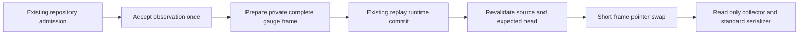

# Task 3 checkpoint: admitted source and committed replay frames

Task 2 was approved at `f63e463c` in
[review 6306103931](https://github.com/bcl1713/starlink-dashboard/pull/403#issuecomment-6306103931).
This checkpoint implements Task 3 only. Stop for review before Task 4. PR #403
remains draft, open and unmerged; #391 remains open. No deployment occurred.

## Publication and source ownership

The replay callback now returns a private complete `GaugeFrame`. Both initial
activation and subsequent collection publish it only after the existing runtime
`commit_tick` succeeds. Preparation, source admission, independent observations
and the existing runtime algorithms retain their existing owners. There is no
new journal, runtime checkpoint, registry lock, numeric shadow store or worker.

Ordinary accepted processing also uses repository admission. It captures the
coordinator/configuration/runtime binding before collection, rejects source
replacement before accepting metrics, and rechecks immediately before the frame
CAS. Identity includes coordinator replacement and reset, configuration content,
current observation, active route, POIs and phase. Live processing revalidates
the already resolved persisted mission; replay reads only its known mission. No
new mission enumeration or filesystem cache is introduced. Phase identity
excludes computed elapsed/countdown fields; their values remain in the frame.

`source_admission.py` contains transient identity helpers. Its strings and
producer-local references are discarded after publication; collectors retain
only the existing immutable frame. Input revalidation, ETA calculation, file
reads, schema validation and serialization all occur outside the frame mutex.
Accepted preparation deliberately retains repository admission to serialize
mutable ETA/detection work with model writers. Scrapers never acquire it.

`route_progress_snapshot()` reads existing simulation progress without advancing
it. Position, progress, mode, route timing, phase, POI values and
successful-update time now travel together. Original acquisition UTC and replay
mission time stay distinct. A retained coordinator fallback is the same
acquisition and adds no observation, smoothing or publication time.

## Failure, recovery and independent measurements

| Boundary                                                   | Result                                                                                                                              |
| ---------------------------------------------------------- | ----------------------------------------------------------------------------------------------------------------------------------- |
| Preparation or runtime commit fails                        | Discard the candidate; existing activation/collection compensation remains; mask only the expected coupled state.                   |
| Source/input identity changes                              | Reject the complete candidate. An expected-head failure/CAS cannot mask or replace a newer publication.                             |
| Optional publication fails after successful runtime commit | Keep committed mission/runtime/coordinator state; mark the expected frame failed and log the error. Do not run pre-commit rollback. |
| Owned replay cancellation                                  | Invalidate only the frame belonging to that runtime/run; unrelated/newer sources remain untouched.                                  |
| Ordinary disconnect                                        | Build a complete unavailable observation using current route/POI/phase inputs and retain the last successful-observation time.      |
| Next admitted observation                                  | Prepare and publish a complete frame through the existing producer; no retry worker or repeat observation is introduced.            |

An accepted callback accounts for its observation once even when optional ETA
preparation fails, runtime commit fails, or publication loses CAS. This includes
the replay preparation-failure counter case explicitly required by review.
Replay network fields remain unavailable and never enter network histograms.
Standard counters/histograms keep their schemas, cumulative values, buckets and
client implementation. The original three independent dormant dish-status clears
on pre-commit replay failures are retained, with two regression cases; the
extracted clear-loop AST is identical to Task 2. Existing independent
mission/GEP updates retain their own clocks and pre-commit behavior; no new
cross-domain atomicity is claimed.

The independent review found two Important issues. A fallible post-commit source
read could enter activation compensation after runtime success. Four regression
cases reproduced this and now pass: post-commit metric failures cannot undo
committed mission, route, coordinator or running/completed runtime state.
Pre-commit failures still exercise the existing compensation paths. The second
issue was the route switch between legacy simulation collection and publication:
route A progress could be labeled as route B. Three barrier-controlled
regressions reproduced it; route manager/ID/object/planned identity is now bound
before collection. Producer-owned actual phase times and materialization of an
empty untimed profile do not count as planned route changes. Existing
live/simulation finite-value tests caught and prevented that over-invalidation
during the fix.

## APIs and compatibility

- Add `prepare_metrics_from_telemetry(...) -> GaugeFrame | None` in the updater
  module. This stages an accepted observation and accounts once; derived refresh
  must use the Task 2 read-only builder instead. Replay callbacks return its
  frame; `None` remains valid for existing adapters that produce no coupled
  metrics.
- Preserve public `update_metrics_from_telemetry(...) -> None`; add optional
  keyword-only coordinator identity/source validation. Disconnect clearing gains
  optional current-context keywords. Add the read-only progress accessor.
- Preserve both exact 70-export compatibility shims, all 29 coupled metric
  family contracts and the position alias. The registry/collector foundation,
  standard serializer, replay runtime algorithms and all independent instrument
  constructor expressions are unchanged from Task 2.
- Add no dependency, deployment, UI, storage migration or #393 label cleanup.

## Verification

Source `a076ced4ca3fbe9700405735189f34ff79d97908` passed:

- **Complete backend: 4,389 passed, 20 unchanged skips, 1 existing Cartopy
  facecolor warning in 626.68 seconds; exit 0 under a 20-minute hard timeout.**
- **Client matrix: 503 passed, 18 unchanged fixture-dependent skips on each of
  prometheus-client 0.19.0 and 0.26.0.** This includes flight-event isolation,
  provenance, replay, live/background, archive, ETA and strict legacy contracts.
- **60 new Task 3 cases**, with no new skip or relaxed existing assertion.
  Black/Ruff, document format/lint/naming and internal links pass. The private
  GitHub comment external-link check has the existing advisory TLS warning; the
  comment was read through the authenticated connector.

The final application/test source manifest matches the tested committed source.
Documentation-only commits do not alter those files.

The new regression matrix covers initial activation, advancing and completed
replay, failures before/inside commit, post-commit publication failure,
cancellation ownership, source/config/mission/reset replacement, newer-head
protection, same-frame clocks/progress/ETA/phase and current-route disconnect.
Real concurrent HTTP scrapes complete while config, route, POI, phase and
mission writers wait behind the producer's existing repository admission.

Retained red cases include early replay visibility; missing source/progress
integration; cancellation/disconnect and retained fallback; stale source/reset
and post-commit input changes; overly broad cancellation invalidation; and the
post-commit compensation finding. Strict compatibility rejected an unnecessary
new shim export, so both shims were restored unchanged. The unchanged wakeup
test caught assumptions about validated models in its lightweight runtime
adapter; the adapter path was preserved without weakening assertions. The first
completed broad run exposed three additional live-recording isolation failures
from mock route models; the same explicit legacy-adapter boundary was preserved,
with all original assertions intact and flight-event tests added to the matrix.
New test setup corrections (route labels/nonuniform progress, replay
availability, required mission transport and original live-client teardown) are
retained in raw logs. The first broad run was deliberately stopped at 35% for
that final dish-clear audit; its process group was verified gone and its partial
output retained. It is not passing full-suite evidence. There is no
missing-eccodes waiver: verification uses the declared 98-package environment
including `eccodes==2.49.0`.

## Component costs and remaining acceptance

These are isolated diagnostics on the Task 3 source, **not** matched
original-app performance evidence. Median wall times:

| Current POIs | Accepted update including revalidation | Input revalidation | Complete-frame publication | Registry collection |
| -----------: | -------------------------------------: | -----------------: | -------------------------: | ------------------: |
|            0 |                               0.736 ms |           0.145 ms |                    5.07 µs |            0.147 ms |
|          100 |                               9.964 ms |           2.236 ms |                   21.23 µs |            0.248 ms |
|        1,100 |                             106.211 ms |          23.712 ms |                  190.31 µs |            1.426 ms |

Publication includes full schema validation outside the pointer mutex. An
uncontended repository gate round trip measured 103 µs median. Across 20
successive updates only the current frame remained reachable at each size.
Single-update traced peaks were approximately 30 KB, 693 KB and 6.97 MB;
retained traced allocations were approximately 13 KB, 168 KB and 691 KB. Timing
and allocation diagnostics were separate. Raw distributions and source hashes
are retained in `source-costs.json`.

Revalidation and admission have a measurable cost, including about 103 ms of
accepted updater processing with 1,100 POIs in this diagnostic. Task 6 must
assess model write/event-loop latency, real source cadence and net CPU/RSS
against matched frozen controls. The probe does not include main-loop
archive/known-mission I/O or replay commit cost. These figures establish neither
application savings nor final synchronization acceptance. The unchanged matched
60-minute soak and #390 integrated acceptance remain mandatory.

## Scope, rollback and evidence

Task 4 still owns startup, route/POI/phase/config notifications, coalesced dirty
refresh, unchanged-source/countdown/expiry refresh, disabled-background one-shot
work and lifecycle shutdown. Only owned cancellation invalidation and truthful
ordinary disconnect preparation were needed here. Task 5 retains outer HTTP
manager-dependency/health/fallback policy; Task 6 retains
production-image/browser acceptance, matched performance/soak and the reviewed
rollback candidate. This intermediate checkpoint must not be released as
complete #391.

Rollback reverts the Task 3 source commits to Task 2 without a durable
migration. That restores the known pre-commit replay-publication hazard; it is
not a reason to deploy that intermediate state. Independent observations are not
rolled back.

All 2,072 original and 128 before-change benchmark files match their frozen
inventories. Task 1 and Task 2 evidence inventories also remain unchanged.
Commands, test output, environment/source hashes, component diagnostics, review
and cleanup evidence are retained in
`.superpowers/sdd/2026-10-21-perf-391-metrics-publication-tasks/evidence/task3/`.
Final cleanup verification is recorded after exact-source tests; retain the open
PR worktree and evidence, with no task-owned runtime left running.
