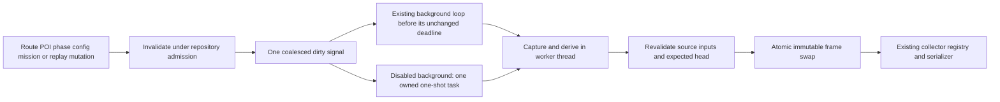

# Task 4 checkpoint: lifecycle metric refresh

Task 3 was approved at `d23815f9` in
[review 6313005132](https://github.com/bcl1713/starlink-dashboard/pull/403#issuecomment-6313005132).
This checkpoint covers Task 4 only. Stop for review before Task 5. PR #403 stays
draft, open and unmerged; #391 stays open. No deployment occurred.

## Ownership and publication

`MetricsRefreshOwner` connects existing mutation boundaries to synchronous
invalidation and coalesced derived work. A completed mutation cannot leave its
previous coupled frame advertised as current: the notification changes the
publication head to pending before returning. The collector keeps the last
committed frame internally, masks unavailable coupled values, and preserves the
successful-observation timestamp. It performs no manager or filesystem work.

Calculation, input capture/revalidation, filesystem access and serialization
remain outside the short frame mutex. Derived calculation retains the existing
repository admission, including its cross-process guard. Nested changes and
compensation can signal early; a worker captures only after that admission is
released. Callbacks only invalidate and signal; they never query managers or
calculate values. One queued wake and one refresh work handle bound event/task
ownership. Reasons are not accumulated into a queue.

The production loop distinguishes dirty wakes from collection/replay wakes. A
dirty wake refreshes metrics while retaining the already scheduled source
deadline. A normal observation that incorporates the dirty revision needs no
additional preparation. Disabled background mode has one event-driven one-shot
task, with no timer or new periodic worker. Startup uses this same owned work
handle to publish initial existing telemetry or complete unavailable/planned
values without source collection.

## Notification boundaries

| Event                             | Owner and behavior                                                                                                                                                                                                                                                                                                         |
| --------------------------------- | -------------------------------------------------------------------------------------------------------------------------------------------------------------------------------------------------------------------------------------------------------------------------------------------------------------------------- |
| Startup                           | Register callbacks after managers are ready, then await one complete initial refresh. No `update()` call.                                                                                                                                                                                                                  |
| Route changes                     | Active add/replacement/reload/removal, activation/deactivation, reload-all, active parse and profile-validation failure. Timing-only replacement updates flight context too. Inactive unrelated routes do not invalidate the current frame. Read failures clear route context without resetting confirmed phase/departure. |
| POI changes                       | Existing save/load/restore publication boundaries cover CRUD, scoped/bulk deletes, projection publication/clear, explicit reload and detected external-file reload.                                                                                                                                                        |
| Phase changes                     | Cheap phase/context/timestamp keys cover manual/automatic phase/mode changes, departure/arrival correction, reset, route-context changes and replay application/restore. Detection-only bookkeeping does not trigger refresh.                                                                                              |
| Configuration                     | Both HTTP methods already call the coordinator. Notifications on accepted coordinator configuration/reset boundaries also cover non-HTTP callers, within existing admission.                                                                                                                                               |
| Mission/planning                  | Existing mission persistence and planning publication/restore boundaries signal without enumerating missions. Paced activation explicitly signals finalized domain inputs before preparation and restored inputs after compensation.                                                                                       |
| Replay terminal changes           | Runtime cancel/fail/selection/mode boundaries notify under repository admission, covering direct API/config/mission callers. `commit_tick`, runtime clocks and compensation algorithms are unchanged.                                                                                                                      |
| Unavailable or retained telemetry | Existing producer deadlines still read current route/POI/phase inputs and refresh planned values/freshness. A retained observation is not observed again.                                                                                                                                                                  |
| Countdown and expiry              | Existing collection deadlines only. Expired retained acquisition becomes unavailable; the last successful observation time is preserved.                                                                                                                                                                                   |
| Shutdown                          | Reject notification admission, detach callbacks, drain owned refresh and source work, invalidate the final head, then close managers.                                                                                                                                                                                      |

Unannounced disk edits in disabled-background test operation require explicit
manager reload. Production route watching and normal periodic POI input checks
remain responsible for discovering edits. Scraping never discovers files.

## Source identity, failure and recovery

Derived refresh can reuse only the current coordinator's last published
acquisition, with matching complete telemetry identity and replay runtime/run/
revision when applicable. Equal acquisition timestamps alone are insufficient:
the internal opaque `observation_id` now hashes the telemetry model. Original
acquisition UTC, position/speed acquisition times, replay mission time and the
successful-publication timestamp remain separate and unchanged. A reset,
cancelled replay or unadmitted replacement produces unavailable observation
values instead of adopting generated defaults. Startup can use actual existing
initial source telemetry explicitly.

A committed replay owns its normalized, retimed plan. Refresh keeps that plan's
mission clock and validates the active route identity and captured file-backed
inputs separately; file timing need not equal normalized replay timing.
Source/config/route/POI/phase/runtime inputs are revalidated immediately before
CAS publication. Replay revalidation still reads only the known mission. No
mission cache is introduced.

| Outcome                                        | Publication and recovery                                                                                                                                                                                                                                                                                                                                        |
| ---------------------------------------------- | --------------------------------------------------------------------------------------------------------------------------------------------------------------------------------------------------------------------------------------------------------------------------------------------------------------------------------------------------------------- |
| New input while preparation is waiting/running | Reject the stale CAS. A newer pending/ready head remains untouched. Coalesce another refresh for the new revision.                                                                                                                                                                                                                                              |
| Calculation/input/admission failure            | Preserve the previous frame internally and expose failed/pending unavailable values. Preserve successful-observation time. No partial labels or values become visible. POI read failures retain their last accepted file signature and explicit failure status; unchanged failures do not keep generating dirty revisions. Existing reads/deadlines retry them. |
| Failure for an obsolete expected head          | Cannot mask or replace a newer observation or completed refresh.                                                                                                                                                                                                                                                                                                |
| Failed current revision                        | Do not spin or schedule a retry timer. The next lifecycle event or existing source deadline provides recovery.                                                                                                                                                                                                                                                  |
| Repeated cancellation                          | Drain the actual work task. That task clears its shared handle before waiters resume, preventing a cancelled waiter from stranding a one-shot on completed work.                                                                                                                                                                                                |
| Shutdown/late callback                         | Detached callbacks and closed-owner admission prevent new work. Thread work is drained before managers close.                                                                                                                                                                                                                                                   |

Derived work never calls source collection, replay preparation/advance, flight
detection, archive writers or accepted metric accounting. ETA uses its existing
detached smoothing/passage state. Independent counters, histograms, GEP and
mission instruments retain their existing owners and contracts.

## Files, APIs and compatibility

- `lifecycle.py`: bounded owner, shared work, dirty wait, cancellation drain and
  callback attachment/removal.
- `refresh_inputs.py`: derived-only capture, provenance, expiry, complete frame
  preparation and final source/CAS admission.
- `services/metrics_changes.py`: optional single callback and cheap mutation
  boundary decorators, including the detachable mission persistence source.
- `main.py`: startup/periodic/retained-source refresh, dirty waits and shutdown.
- Route/POI/flight managers, coordinators, replay terminal methods and existing
  mission/planning/activation boundaries: notifications under existing
  admission.
- `metric_updater.py`: capture the expected head after accepted phase/input
  notifications. An internal optional `_captured_head` callback returns that
  exact head to the ordinary producer; return types and compatibility exports
  are unchanged. Replay still publishes only after runtime commit.
- `source_admission.py` and `POIManager.metrics_input_identity()`: rehash
  current models through the existing access gate without allocating another
  detached POI list. This still detects disk changes and legacy mutable aliases;
  it is not a revision cache or another numeric store.

The immutable store/collector, 29 metric schemas, position alias, both 70-name
compatibility shims, registry, exporter and standard independent instrument
constructors are unchanged. No dependency, serializer, deployment or public HTTP
API change is introduced. No private prometheus-client dependency is added.

## Regression and compatibility evidence

Exact application/test source `2ff89c83f1746c53b1f7ecfc5dfcd46c95b69a54` passed:

- **Full declared-environment backend: 4,460 passed, 20 existing skips, 1
  existing Cartopy facecolor warning in 587.12 seconds**, exit 0 under a
  20-minute hard timeout with 10-second forced-termination grace.
- **574 passed, 18 existing fixture-dependent skips on each of prometheus-client
  0.19.0 and 0.26.0**, each under an 8-minute hard timeout. This includes ETA,
  frame/view/registry contracts, live/replay/source ordering, flight/archive,
  strict import compatibility and all lifecycle cases.
- **71 new Task 4 cases**, with no new skips or weakened existing assertions.
  Verification includes declared ecCodes dependencies (`eccodes==2.49.0`); there
  is no missing-dependency waiver.

Final source/test hashes match the full and client runs. Subsequent checkpoint
documentation does not change those files.

The Task 4 matrix covers startup, timing-only edits, active parse/profile
failure, real external route/POI reload, seven bulk deletion methods, projection
publication/clear, restore/rollback, phase and config changes, persisted mission
notification, replay cancellation/failure/selection, expiry, same-timestamp
replacement, stale failure/newer-head rejection and shutdown. Barriers overlap
actual telemetry production, refresh, config/route/mission writers and HTTP
scrapes. Dirty wakes retain collection deadlines. Live/simulation/replay clock,
ETA history, flight detection and independent observation samples remain intact.

Every existing assertion is retained. Two Task 3 suites explicitly close the
automatic lifecycle owner because they manually inject publication heads and own
producer barriers. The Task 4 suites separately test the fully wired
production/refresh/writer/scrape combination. Existing 100-scrape exporter
purity, 150-knot preflight, replay commit, metric contract and import tests
remain.

Retained failures include missing lifecycle ownership, self-invalidated phase
acceptance, redundant POI copying, active-route parse/profile failure,
same-timestamp payload admission, unexpected owner failure, registration after
close, transient/malformed POI reloads, and preservation of confirmed flight
state after route read failure. Initial regressions also exposed
manual-publication test ownership assumptions; assertions were preserved. The
cancellation-handoff reproducer hit its 15-second hard limit, confirmed the
spin, and passed after the ownership fix. The first broad run was deliberately
interrupted at 21% for this fix; a second was interrupted at 29% after
reproducing cancellation of complete teardown and failed-startup cleanup; a
third at 38% for POI read recovery. All three groups were verified gone and
their partial logs retained. None is passing full-suite evidence. Complete
teardown now drains in an owned task, and lifespan cleanup runs in `finally`,
including failed startup. A new notification test initially misplaced its
trailing bulk assertions; they were restored to the bulk test without weakening
them. The final source-generation test initially expected pending after an
unannounced source replacement; failed is correct for that unchanged revision,
with recovery on the next lifecycle event.

An exploratory root-directory Ruff run reported 35 import-order diagnostics
because the backend `app` source root was inferred differently.
Backend-directory Ruff and the root command with explicit
`src = ["backend/starlink-location"]` both pass; no unrelated
imports/configuration were changed. Black checks all 423 application files.
Internal documentation links pass; the private GitHub comment URL has the
existing advisory certificate/network warning and was read through the
authenticated connector.

## Component measurements and remaining acceptance

These are component diagnostics using the retained Task 3 measurement method,
not frozen-original application comparisons. Median wall times:

|  POIs | Accepted update | Input revalidation | Registry collection | Derived refresh API with callbacks |
| ----: | --------------: | -----------------: | ------------------: | ---------------------------------: |
|     0 |        0.753 ms |           0.149 ms |            0.150 ms |                           0.744 ms |
|   100 |        7.969 ms |           0.475 ms |            0.250 ms |                           8.242 ms |
| 1,100 |       82.605 ms |           3.618 ms |            1.310 ms |                          83.117 ms |

The same Task 3 diagnostic reported 106.211 ms accepted updates and 23.712 ms
revalidation at 1,100 POIs. Warm Task 4 accepted updates with callbacks measured
85.057 ms median. A dirty notification took about 1.1 µs median; every
10-notification burst prepared exactly one frame. Twenty successive publications
retained only the current frame at all three sizes. Single-refresh traced peaks
were about 35 KB, 701 KB and 6.98 MB; retained traced allocations were about 15
KB, 147 KB and 695 KB. Timing and allocation runs were separate.

Both final probes ran at `2ff89c83`, with exact component source hashes
retained. Full schema-validated publication at 1,100 POIs measured 194.37 µs
median, outside the short pointer mutex. Raw construction, p50/p95 wall/thread
CPU, publication, collection, allocation and ownership results remain in the
committed artifact and retained evidence.

The POI revalidation change removes the second deep copy, retaining a fresh
model hash and existing file checks. Measurements include short pointer
synchronization and existing repository admission. They do not include all
main-loop archive/mission I/O or establish application CPU/RSS savings. Large
POI calculations still retain repository admission and can delay model writers;
Task 6 must measure source cadence and event-loop/writer latency under matched
load. General mission caching remains #392.

Task 5 still owns remaining outer HTTP dependency/health/fallback policy and
regressions; this task introduces no new scrape retry or contention-503 policy.
Task 6 still requires the frozen original/candidate comparison, real 1 Hz
ingestion, all separate activity cases, production-path controls and the minimum
60-minute steady soak. The #390 integrated acceptance gate is unchanged. No
application-level improvement or soak acceptance is claimed here.

## Rollback, baseline and cleanup

Rollback is source-only: revert Task 4 commits in reverse order in a separate
reviewed change to restore Task 3 lifecycle behavior. There are no migrations,
runtime configuration changes or deployment actions to undo. Existing Task 3
replay commit ordering and independent instruments remain available.

All 2,072 frozen-original and 128 before-change files verify unchanged, as do
the 26/28/86-file Task 1/2/3 inventories. Raw Task 4 evidence has its own
SHA-256 inventory. Host process/listener and actor Docker checks are retained at
handoff; task-owned test groups and temporary paths are removed after their
final checks. No Compose project, server, container or volume was started by
this task. The open worktree and evidence are retained.

The original application `25e34168f0e2cecb149b0323f1f5a795cb28cae0`, frozen
harness `13cbf1d54b526307747578ecd4fc691562846834` and instrumented base
`33b60fa85c0d0b80d9b82ea5eac7d612a54f4c96` remain fixed. Previous evidence is
not overwritten or reclassified. Raw Task 4 commands, owners, failures,
distributions, source hashes and cleanup checks are retained under this plan's
`evidence/task4/`; the committed
[result artifact](probes/perf391-task4-results.json) indexes the checkpoint.
