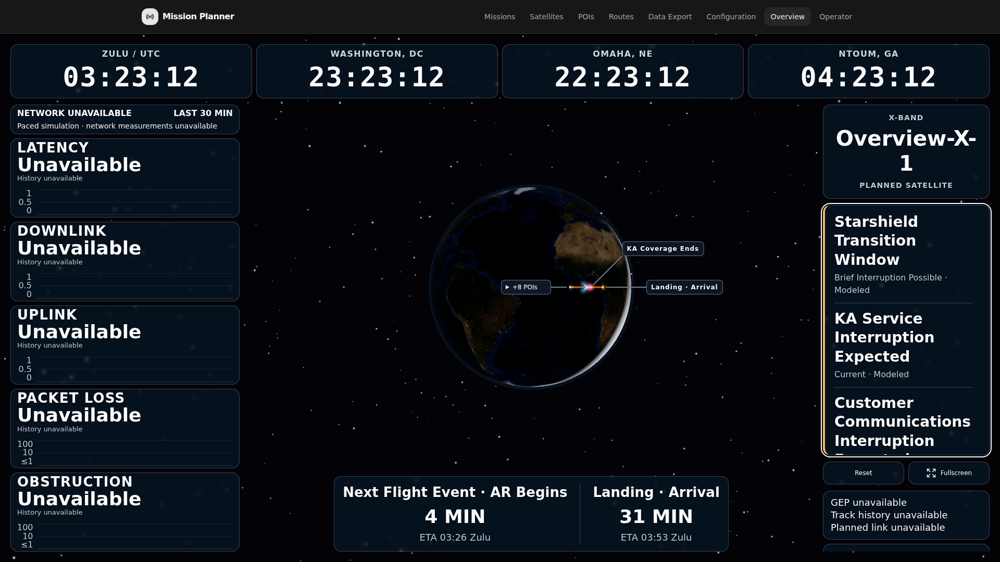
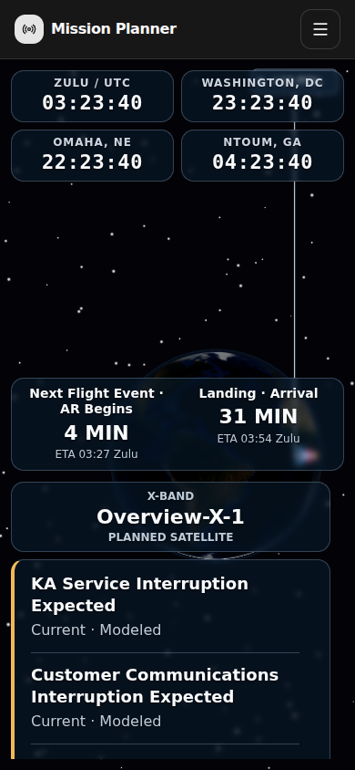
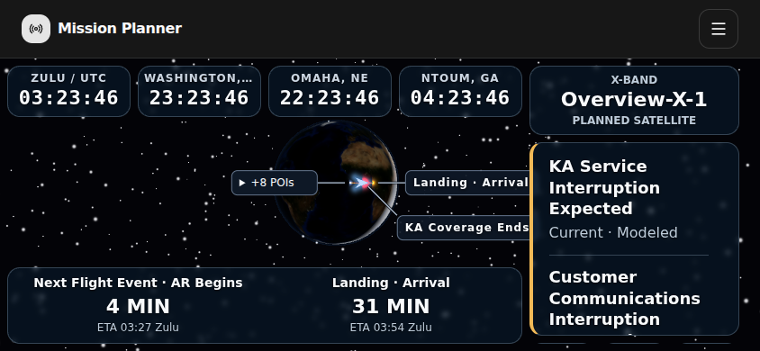

# Overview Presets and Shared Advisories Acceptance

Issue [#426](https://github.com/bcl1713/starlink-dashboard/issues/426) uses the
existing shared Overview presets. Configure the panels and layers in Operator's
display tools, choose **Flight Events Only** if desired, then **Save Current As
Customer**. **Apply Customer** restores that saved configuration on all Overview
displays. Normal, Communications and Weather can also save either value. There
is no separate customer URL. An older saved preset restores all-event selection.

Overview reads the existing Operator event ledger. Operator acknowledgment
removes that occurrence from polling displays; history remains in Operator.
Visible displays poll every 15 seconds, hidden displays every 60 seconds, and
focus/online events refresh them. Failed, stale or mismatched sources show a
brief availability cue and suppress affected advisories.

## Production Browser Evidence

Tested candidate: `6ad0649b875f9acbdbf9db4e612b97a89f29da5b`.
The production backend and Nginx frontend images were built from that exact Git
archive. The [machine-readable result](summary.json) records image IDs, source
archive hash, scenario results and owned-resource cleanup.

The journey passed with two independent Overview browser contexts and an
Operator context, including different browser time zones:

- Customizable Customer and Normal presets, shared application and flight-only
  selection independent of map filters.
- Simultaneous Starshield transition, KA, X-Band and combined transport sources.
- A real acknowledgment with its response deliberately lost, followed by retry
  using the same key/body and the original durable receipt.
- Two-client polling suppression, persistence after reload, retained Operator
  history and no Overview audio.
- Changed ETA retaining acknowledgment, a new active leg rearming its own
  occurrence, and expired snapshot rejection.
- Source loss removing the affected transition advisory and retaining an
  unavailable/stale cue.
- Desktop bounds and keyboard scrolling, plus portrait and landscape renders
  without horizontal overflow. The overflow stress inserts render-only DOM
  copies; it does not claim twelve actual simultaneous predictions.

The fixture supplies synthetic raw KML, RF catalogs and telemetry/clock inputs.
Normal startup, prediction, active context, event projection, ledger writes and
acknowledgment APIs remain production code. Headless Chromium uses software
rendering. This is application acceptance evidence, not aircraft or RF hardware
validation. No browser errors or unexpected external requests were recorded.

The complete logs, ownership records and browser traces are retained in the
task environment at `/tmp/issue426-acceptance-r8`. The runner removed its images,
containers, networks, private volumes, temporary source archive, listener and
child processes. The open-PR worktree remains available for review.

## Additional Verification and Backout

The full frontend unit suite passed 2,218 tests in 320 files. The combined
Operator, POI and settings/preset backend suite passed 834 tests. TypeScript,
ESLint and production image builds passed. Pure tests
cover snapshot pagination, clock/context isolation, source freshness, exact
visibility thresholds, legacy generated labels and strict preset compatibility.
An unrestricted frontend rerun had one settings-control loading timeout while
the lint gate ran concurrently; that file passed all twelve tests in isolation.
The final full frontend run limits concurrency to four workers.

Follow the [preset backout procedure](../../development/overview-preset-backout.md)
before reverting the backend: older code requires removal of the new preference
from nested saved bundles. The helper preserves other settings and writes a
separate file. No acknowledgment database migration or history deletion is
required.
