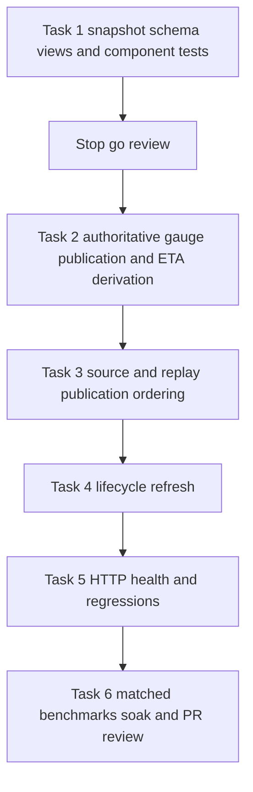

# Producer owned gauge snapshot implementation plan

> **For agentic workers:** REQUIRED SUB-SKILL: Use superpowers:executing-plans
> for native execution; use subagent-driven execution only if the user later
> requests it. Task 3 is authorized after the reviewed Task 2 checkpoint; stop
> before Task 4.

**Goal:** Eliminate scrape-time simulation/ETA/storage work with one bounded,
consistent snapshot for coupled gauges and unchanged independent instruments.

**Architecture:** A registered collector captures one immutable gauge frame;
producers replace that frame with a short compare-and-swap under a mutex.
Standard independent Gauge, Counter and Histogram objects retain their existing
owners. There is no global epoch, client-internal undo, or replay checkpoint.

**Tech stack:** Python 3.11, FastAPI/Starlette threadpool, existing repository
admission and asyncio update loop, public prometheus-client APIs, pytest, and
the frozen #390 Docker/Playwright harness. No dependency/deployment change.

**Specification:**
[Revised design](../specs/2026-10-21-perf-391-metrics-publication-design.md),
[ownership contract](../specs/2026-10-21-perf-391-metrics-publication-contracts.md),
and
[architecture decision and probe](../specs/2026-10-21-perf-391-metrics-publication-decision.md).

**Status:** Design approved at `c7792320`; Task 1 passed review at `b2c90832`
and Task 2 at `f63e463c`. Task 3 implementation is at its
[review checkpoint](../../performance/perf-391-task-3-checkpoint.md), including
post-commit replay/source ordering and the two independent-review fixes. Tasks
4–6 remain unstarted; stop for review before Task 4.

## Global constraints

- Zero simulator/ETA/mission/POI work or source advancement during scraping.
- One numeric authority for the coupled families; no duplicate mutable gauges.
- One pointer mutex; no calculation, filesystem access, collection,
  serialization or wait while holding it. No global scrape retry/undo subsystem.
- Independent counters/histograms retain standard semantics and client types.
- Preserve live/simulation/replay/planned provenance, preflight behavior and
  acquisition times. Derived refresh does not observe an existing sample again.
- No new periodic worker, UI change, mission cache, storage migration,
  dependency pin, general label sweep or `mission_active_info` repair (#393).
- Preserve original `25e34168f0e2cecb149b0323f1f5a795cb28cae0`, investigation
  base `33b60fa85c0d0b80d9b82ea5eac7d612a54f4c96`, and per-case measurement
  harness `13cbf1d54b526307747578ecd4fc691562846834`; retain every original
  digest/guard.
- No application implementation before approval; no deployment, merge or issue
  closure without separate authorization.

Continue in `.worktrees/perf-391-readonly-metrics` on
`perf/391-readonly-metrics`; primary checkout stays on `dev`. Fetch/revalidate
upstream drift before later implementation. Do not replace frozen references
with preceding-dev-only evidence.

## Review focus

1. A hidden caller expects a real Gauge or `_value`: audit all import/write
   sites and stop at the compatibility checkpoint rather than building a proxy.
2. A producer finishes after config/mission replacement: compare the captured
   publication head/source identity before swapping; discard obsolete work.
3. A timing-only correction bypasses phase callbacks: notification and refresh
   must still run without collecting telemetry.
4. A failed preparation or abandoned new label must not become a finite live
   observation or create a visible zero-valued child.
5. Many mutations overlap shutdown: retain at most one coalesced one-shot task
   and prevent detached callbacks from resurrecting work.

## Components and file responsibilities



| File under `backend/starlink-location` unless otherwise stated                                                              | Change                                                                                                                                            |
| --------------------------------------------------------------------------------------------------------------------------- | ------------------------------------------------------------------------------------------------------------------------------------------------- |
| `app/core/metrics/frames.py` (new)                                                                                          | Immutable frame/state/store, registered collector, small frame-backed handles; no client-private access                                           |
| `app/core/metrics/frame_builder.py` (new)                                                                                   | Complete accepted/derived/unavailable frame preparation from detached inputs                                                                      |
| `app/core/metrics/lifecycle.py` (new)                                                                                       | Bounded invalidation/refresh owner; existing-loop dirty wake and disabled-mode one-shot                                                           |
| `app/core/metrics/prometheus_metrics.py`                                                                                    | Declare 29 coupled schemas through handles, register one collector, retain 18 ordinary Gauges, seven Counters, four Histograms and position alias |
| `app/core/metrics/metric_updater.py`, both metric import shims                                                              | Keep named helper/import contracts; stage coupled writes; leave independent instrument semantics intact                                           |
| `app/core/eta_service.py`, `app/services/eta_calculator.py`, `app/services/eta/projection.py`                               | Explicit read-only derivation using detached smoothing state; preserve calculation formulas/defaults                                              |
| `main.py`, `app/simulation/coordinator.py`                                                                                  | Correct complete-frame preparation and accounting; eliminate early progress writes; preserve update deadline and cleanup                          |
| `app/simulation/run_service.py`, `app/mission/leg_activation.py`                                                            | Stage gauge frame in existing callback, publish after successful `commit_tick`; preserve existing failure handling                                |
| `app/services/route_manager.py`, `app/services/poi/manager.py`, `app/services/flight_state/manager.py`, `app/api/config.py` | Notify accepted input changes, including reload, timing-only edits and transaction restore                                                        |
| `app/api/metrics.py`, `app/api/metrics_export.py`, `app/api/health.py`                                                      | Pure exposition, same-source position table and truthful publication health                                                                       |
| `tests/unit/test_metrics_frames.py`, `test_metrics_frame_views.py` (new)                                                    | Real schema, view compatibility, atomic old/new frame and failure tests                                                                           |
| `tests/integration/test_metrics_publication_lifecycle.py` (new), existing metrics/ETA/replay tests, `tests/conftest.py`     | Replace private Gauge/dictionary fixture writes with explicit frame publication; preserve all regression assertions                               |
| Repository `docs/performance/probes/perf391_snapshot.py`                                                                    | Already-created disposable public-API feasibility probe; never imported by application code                                                       |
| Repository `docs/performance/perf-391-results.md` (future)                                                                  | Matched system measurements, limitations, source correctness, soak/cleanup and rollback evidence                                                  |

Do not modify `app/simulation/run_runtime.py` to add metric transactions or
checkpoints. Do not change GEP ownership or independent metric implementation.
Record their existing behavior in regression tests instead.

## Task interfaces and execution checkpoint

The [six task definitions](2026-10-21-perf-391-metrics-publication-tasks.md) are
part of this plan. They pin frame/store/view interfaces, file changes, failing
tests, verification and commit boundaries. Task 1 is at checkpoint review; Tasks
2–6 remain unstarted.

After written-artifact approval, Task 1 establishes the actual 29-family schema
and compatibility/concurrency component tests. Stop and present its evidence for
a go/no-go review **before** production producer/replay/lifecycle integration.
The disposable three-family probe is feasibility evidence, not permission to
skip that checkpoint. Unknown operational raw-Gauge dependencies, duplicate
state, unbounded retention, or erased savings return the design to review.

## Verification commands

Focused development commands run from `backend/starlink-location`. Use a unique
task data path for every run and record ownership before starting. Example:

```bash
STARLINK_TEST_DATA_DIR=/tmp/perf391-tests-r1 \
  timeout --kill-after=10s 10m uv run \
  --with-requirements requirements-dev.txt --with pytest --with pytest-asyncio \
  pytest tests/unit/test_metrics_frames.py tests/unit/test_metrics_frame_views.py \
  tests/unit/test_metrics_export.py tests/unit/test_metrics.py \
  tests/unit/test_eta_service.py \
  tests/integration/test_metrics_publication_lifecycle.py \
  tests/integration/test_metrics_endpoint.py tests/integration/test_eta_modes.py \
  tests/integration/test_live_background_route.py
```

Repeat the frame/view unit tests with `--with 'prometheus-client==0.19.0'` and
the independently recorded deployed version, in separate temporary test
environments. Expected result: all supported-client tests pass, no skipped
snapshot/compatibility cases, and no dependency-manifest modifications.
Investigate incompatibility rather than raising the minimum version without
approval.

Canonical commands run from repository root with recorded ownership and explicit
limits, following [quality gates](../../contributing/quality-gates.md):

```bash
ACCEPTANCE_POLICY_BASE_SHA=$(git merge-base origin/dev HEAD) \
  timeout --kill-after=10s 10m ./tools/verify static
timeout --kill-after=10s 30m ./tools/verify backend
```

These are future execution commands, not checks claimed by this documentation
change. Use the repository's full applicable acceptance gates before PR review.

## Frozen harness benchmark and soak procedure

Create a detached, temporary measurement checkout at the exact case harness SHA;
the feature worktree remains separate. Use the existing installed Playwright
through a recorded task-owned symlink if needed. Never modify the frozen runner,
install a different browser silently, or run benchmark projects concurrently.
Set evidence/project names once per immutable run.

From repository root, prepare the measurement checkout:

```bash
git worktree add --detach .worktrees/perf391-measurement \
  13cbf1d54b526307747578ecd4fc691562846834
```

From that checkout, run each original/control/candidate SHA with the same flags
and unique output/project names. Example warmed off case:

```bash
timeout --kill-after=20s 30m python3 tools/acceptance/performance/run.py \
  --sha <committed-application-sha> \
  --project starlink-operator-perf391-candidate-off-r1 \
  --output /tmp/perf391-evidence/candidate-off-r1 \
  --viewers 2 --operator --window 1800 --warmup 120 --duration 180 \
  --instrumentation off --total-timeout 1750
```

Repeat with distinct names for r2/r3 and original SHA, then counters. Retain
no-viewer and one-fullscreen-viewer controls where they distinguish scrape cost
from browser contention; compare each only with matching original workload. Use
the current report tool from the implementation checkout:

```bash
python3 tools/acceptance/performance/report.py \
  /retained/original-case/summary.json /retained/candidate-case/summary.json
```

If any comparison-integrity guard rejects, keep the rejection and add a matched
run. Do not trim summaries, loosen guards, substitute observer-arrival latency,
or normalize mismatched identities in place. The legacy frozen harness's root
Python package metadata is not the application inventory: independently record
`docker exec --user appuser ... python -m pip list --format=json` during setup
or warm-up, compare with the corrected original, and retain its hash separately.

For steady-state soak use the same frozen checkout, with a unique project and
output for each original/candidate run:

```bash
timeout --kill-after=20s 2h python3 tools/acceptance/performance/run.py \
  --sha <committed-application-sha> \
  --project starlink-operator-perf391-candidate-soak-r1 \
  --output /tmp/perf391-evidence/candidate-soak-r1 \
  --viewers 2 --operator --window 1800 --warmup 120 --duration 3660 \
  --instrumentation off --total-timeout 7100
```

Require summary `measured_span_seconds >= 3600`, complete browser polling and
Prometheus ingestion, successful request coverage, no synchronization-induced
scrape failures, and explicit resource cleanup. Run a separate matched activity
workload with `--operations`, keeping those distributions separate. The
60-minute simulation soak cannot prove accepted-live archive behavior or
eight-hour stability. At failures/timeouts, verify old process trees before
retrying and retain partial evidence; do not restart into occupied projects.

## Approval and handoff

Both revised written artifacts were approved at `c7792320`. Native execution is
recommended because the store/view/builder interfaces are tightly related.
Approval does not remove the Task 1 stop/go review, the 60-minute acceptance
gate, or separate deployment/merge/closure authorizations. Keep PR #403 draft.
