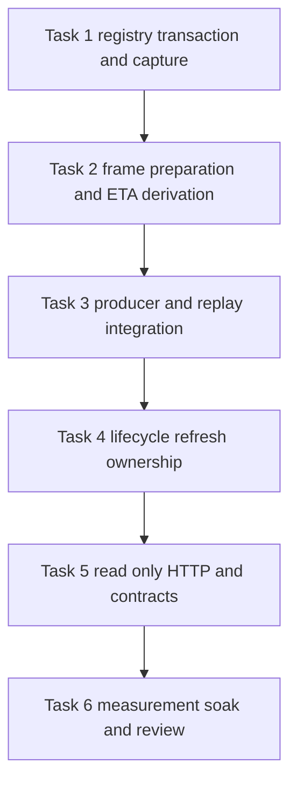
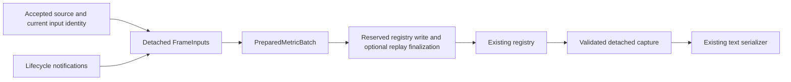

# Producer owned metrics publication implementation plan

> **For agentic workers:** REQUIRED SUB-SKILL: Use superpowers:executing-plans
> for native execution, or superpowers:subagent-driven-development only if the
> user selects delegation. Execute task by task after separate
> written-specification and plan approval.

**Goal:** Make `/metrics` a read-only collection of a consistent registry
generation while preserving source, preflight, replay, and Prometheus contracts.

**Architecture:** Keep the existing Prometheus client objects and registry as
the only authoritative metric store. Producers prepare batches, reserve a write
epoch, apply with a temporary undo journal, and finalize the epoch; scrapers
accept detached collections only across unchanged even epochs. Existing-loop
dirty wakes and a disabled-background one-shot path refresh lifecycle changes.

**Tech Stack:** Python 3.11, FastAPI/Starlette threadpool, asyncio, existing
Python Prometheus client and repository admission, pytest, existing #390 Docker
and Playwright acceptance tooling. No dependency or deployment change.

**Spec:**
[Read only metrics scraping and producer publication](../specs/2026-10-21-perf-391-metrics-publication-design.md).

**Status:** Documentation only, awaiting separate approval of both artifacts.
The user explicitly requested both documents together; writing this plan does
not imply approval of the accompanying specification. No task below has begun.

## Global constraints

- The existing Python Prometheus registry remains the only authoritative metric
  store.
- No exposition byte cache, replacement metric implementation, new periodic
  worker, or external infrastructure is added.
- Publication synchronization must not perform domain calculations, filesystem
  operations, registry collection, or exposition serialization while holding the
  publication mutex.
- Derived refresh does not mutate any telemetry timestamps, replay runtime
  revision/frame, or the successful-telemetry last-update gauge.
- Do not change ETA algorithms, mission lookup caching, history cadence,
  transport modeling, evidence recording, or UI.
- General stale-label/cardinality repair, including the existing
  `mission_active_info` empty-route child bug, remains #393.
- Do not deploy, merge, or close #391 without separate authorization.
- Preserve frozen original application
  `25e34168f0e2cecb149b0323f1f5a795cb28cae0` and per-case harness
  `13cbf1d54b526307747578ecd4fc691562846834`; never rewrite original evidence,
  the before-change controls, or comparison guards.

Use the existing feature worktree and branch. Before implementation, fetch
`origin/dev` and compare it with the documented base; preserve reviewed
documents, rebase and revalidate drift if needed. Do not create another feature
branch for these same tasks or edit the primary checkout. All commands below run
inside the feature worktree unless a frozen harness checkout is specified.

## Review focus

1. A client library upgrade changes histogram internals: fail closed rather than
   corrupt cumulative buckets; covered by Task 1 compatibility tests.
2. A replay finalizer mutates runtime and then raises: restore its in-memory
   checkpoint and registry before any success response; covered by Task 3.
3. A timing-only correction does not trigger a phase callback: explicitly notify
   and refresh without telemetry; covered by Task 4.
4. An external POI edit occurs while no telemetry arrives: existing periodic
   refresh must observe file reload; covered by Task 4.
5. Many POIs change during shutdown: coalesce work and prevent callback-driven
   task resurrection after draining; covered by Task 4.

## Components, interfaces, and file map





| File                                                                    | Responsibility and planned change                                                                                                                 |
| ----------------------------------------------------------------------- | ------------------------------------------------------------------------------------------------------------------------------------------------- |
| `app/core/metrics/publication.py` (new)                                 | Epoch admission, operation types, touched-state undo journal, client-shape guard, snapshot validation, bounded retries and explicit failure state |
| `app/core/metrics/frame_builder.py` (new)                               | Detached frame inputs; full, derived-only, and unavailable batches; targeted active-frame invalidation                                            |
| `app/core/metrics/lifecycle.py` (new)                                   | Input revision and dirty-event owner; callbacks, one-shot fallback, task drain                                                                    |
| `app/core/metrics/prometheus_metrics.py`                                | Bind one coordinator to existing registry and position store; retain all definitions and PositionCollector format                                 |
| `app/core/metrics/metric_updater.py`                                    | Preserve compatibility functions while routing every mutation through prepared batches                                                            |
| `app/core/metrics/__init__.py`, `app/core/metrics.py`                   | Keep current import contracts and expose internal coordinator where required                                                                      |
| `app/core/eta_service.py`                                               | Accepted-sample entry point and read-only derivation with detached smoothing state                                                                |
| `app/services/eta_calculator.py`, `app/services/eta/projection.py`      | Optional passage-tracking switch, default unchanged; no ETA formula changes                                                                       |
| `main.py`                                                               | Startup frame, producer accounting, dirty-wake scheduling, unchanged collection deadline, disconnect refresh, lifespan cleanup                    |
| `app/simulation/coordinator.py`                                         | Stop early progress-gauge mutation; provide frame progress to publisher                                                                           |
| `app/simulation/run_service.py`, `app/simulation/run_runtime.py`        | Prepared metric batch plus in-memory replay checkpoint/finalization/rollback                                                                      |
| `app/mission/leg_activation.py`                                         | Join startup tick publication to existing activation transaction and restore on failure                                                           |
| `app/services/ground_entry_point.py`                                    | Preserve resolver behavior; group metric set/clear operations transactionally                                                                     |
| `app/services/route_manager.py`                                         | Optional accepted-mutation notification including active parse failure/reload/removal                                                             |
| `app/services/poi/manager.py`                                           | Notify accepted POI publication, bulk operations, reload, projection, and checkpoint restoration                                                  |
| `app/services/flight_state/manager.py`                                  | Notify accepted phase, mode, route-context, and timing-only mutations without recursion                                                           |
| `app/api/config.py`                                                     | Notify successful configuration replacement and coordinator lifecycle changes                                                                     |
| `app/api/metrics.py`, `app/api/metrics_export.py`                       | Remove manager dependencies; use capture for normal/fallback serialization; preserve probe callable                                               |
| `tests/unit/test_metrics_publication.py` (new)                          | Atomicity, rollback, client contracts, lock boundaries and custom registries                                                                      |
| `tests/unit/test_metrics_frames.py` (new)                               | Frame ownership, source identity, preflight and targeted invalidation                                                                             |
| `tests/integration/test_metrics_publication_lifecycle.py` (new)         | Concurrent producer/lifecycle/replay and task cleanup                                                                                             |
| Existing metrics, ETA, live-background and replay tests                 | Migrate scrape-owned fixtures to explicit producer publication and retain regression assertions                                                   |
| `tools/acceptance/performance/metrics_publication_diagnostics.py` (new) | Separate bounded component/allocation diagnostics; no production instrumentation                                                                  |
| `docs/performance/perf-391-results.md` (new, during acceptance)         | Matched results, limitations, failure evidence, cleanup, rollback and PR review references                                                        |

Paths in that table are relative to `backend/starlink-location` for `app/` and
`tests/`, and repository-relative for `main.py` only as
`backend/starlink-location/main.py`; `tools/` and `docs/` are
repository-relative.

Internal types are frozen dataclasses except the coordinator/owner. The
operation union consists of `GaugeSet(metric, labels, value)`,
`CounterAdd(metric, labels, amount)`, `HistogramObserve(metric, labels, value)`,
and `PositionSet(latitude, longitude, altitude)`. Labels are normalized tuples
in the existing metric's label-name order. Operations refer to existing parent
objects without calling `.labels()` during preparation. A batch carries
`identity`, `operations`, `full_frame`, and `admit_observation`.

`MetricInputIdentity` fields are `input_revision`, `mode`, `coordinator_token`,
`observation_key`, `observed_at`, `speed_observed_at`, `route_revision`,
`poi_revision`, `phase_revision`, `replay_runtime_id`, `replay_run_id`,
`replay_revision`, and `simulation_time`; unavailable fields are `None`. Reuse
existing source/replay identifiers and authoritative revision checks; local
counters only invalidate and never replace disk coherency checks.

The producer regression file set includes
`tests/unit/test_simulation_run_service.py`,
`tests/unit/test_simulation_run_runtime.py`,
`tests/unit/test_simulation_run_timing.py`,
`tests/unit/test_ground_entry_point.py`,
`tests/integration/test_simulation_run_lifecycle.py`, and
`tests/integration/test_simulation_run_time_apis.py`, in addition to the focused
metrics/ETA files below. Task 3 owns their producer assertions; Task 4 owns
lifecycle notification/cancellation assertions.

## Ordered implementation tasks

The [six task definitions](2026-10-21-perf-391-metrics-publication-tasks.md) are
a required part of this plan. Execute registry foundation, frame/ETA
preparation, producer/replay integration, lifecycle ownership, read-only HTTP,
and measured acceptance in that order. Each task includes its failing tests,
interfaces, implementation changes, verification, and commit boundary.

## Verification commands

Focused development commands run from `backend/starlink-location`. Use a unique
task data path for every run and record ownership before starting. Example:

```bash
STARLINK_TEST_DATA_DIR=/tmp/perf391-tests-r1 \
  timeout --kill-after=10s 10m uv run \
  --with-requirements requirements-dev.txt --with pytest --with pytest-asyncio \
  pytest tests/unit/test_metrics_publication.py tests/unit/test_metrics_frames.py \
  tests/unit/test_metrics_export.py tests/unit/test_metrics.py \
  tests/unit/test_eta_service.py \
  tests/integration/test_metrics_publication_lifecycle.py \
  tests/integration/test_metrics_endpoint.py tests/integration/test_eta_modes.py \
  tests/integration/test_live_background_route.py
```

Repeat the publication unit tests with `--with 'prometheus-client==0.19.0'` and
the independently recorded deployed version, in separate temporary test
environments. Expected result: all supported-client tests pass, no skipped
rollback/atomicity cases, and no dependency-manifest modifications. Investigate
incompatibility rather than raising the minimum version without approval.

Canonical commands run from repository root with recorded ownership and explicit
limits, following [quality gates](../../contributing/quality-gates.md):

```bash
ACCEPTANCE_POLICY_BASE_SHA=$(git merge-base origin/dev HEAD) \
  timeout --kill-after=10s 10m ./tools/verify static
timeout --kill-after=10s 30m ./tools/verify backend
```

These are future execution commands, not checks claimed by this documentation
change. Use the repository's full applicable acceptance gates before PR review.

## Frozen harness benchmark and soak procedure

Create a detached, temporary measurement checkout at the exact case harness SHA;
the feature worktree remains separate. Use the existing installed Playwright
through a recorded task-owned symlink if needed. Never modify the frozen runner,
install a different browser silently, or run benchmark projects concurrently.
Set evidence/project names once per immutable run.

From repository root, prepare the measurement checkout:

```bash
git worktree add --detach .worktrees/perf391-measurement \
  13cbf1d54b526307747578ecd4fc691562846834
```

From that checkout, run each original/control/candidate SHA with the same flags
and unique output/project names. Example warmed off case:

```bash
timeout --kill-after=20s 30m python3 tools/acceptance/performance/run.py \
  --sha <committed-application-sha> \
  --project starlink-operator-perf391-candidate-off-r1 \
  --output /tmp/perf391-evidence/candidate-off-r1 \
  --viewers 2 --operator --window 1800 --warmup 120 --duration 180 \
  --instrumentation off --total-timeout 1750
```

Repeat with distinct names for r2/r3 and original SHA, then counters. Retain
no-viewer and one-fullscreen-viewer controls where they distinguish scrape cost
from browser contention; compare each only with matching original workload. Use
the current report tool from the implementation checkout:

```bash
python3 tools/acceptance/performance/report.py \
  /retained/original-case/summary.json /retained/candidate-case/summary.json
```

If any comparison-integrity guard rejects, keep the rejection and add a matched
run. Do not trim summaries, loosen guards, substitute observer-arrival latency,
or normalize mismatched identities in place. The legacy frozen harness's root
Python package metadata is not the application inventory: independently record
`docker exec --user appuser ... python -m pip list --format=json` during setup
or warm-up, compare with the corrected original, and retain its hash separately.

For steady-state soak use the same frozen checkout, with a unique project and
output for each original/candidate run:

```bash
timeout --kill-after=20s 2h python3 tools/acceptance/performance/run.py \
  --sha <committed-application-sha> \
  --project starlink-operator-perf391-candidate-soak-r1 \
  --output /tmp/perf391-evidence/candidate-soak-r1 \
  --viewers 2 --operator --window 1800 --warmup 120 --duration 3660 \
  --instrumentation off --total-timeout 7100
```

Require summary `measured_span_seconds >= 3600`, complete browser polling and
Prometheus ingestion, successful request coverage, no steady-state contention
503s, and explicit resource cleanup. Run a separate matched activity workload
with `--operations`, keeping those distributions separate. The 60-minute
simulation soak cannot prove accepted-live archive behavior or eight-hour
stability. At failures/timeouts, verify old process trees before retrying and
retain partial evidence; do not restart into occupied projects.

## Approval and execution handoff

The written specification and this plan each require explicit user approval.
Recommend native execution because these six tasks share registry and producer
interfaces and benefit from one consistent integration context. No subagents are
authorized at the documentation stage. If the user selects delegation, follow
the corresponding execution skill after approval. Authorizations for deployment,
merge, and issue closure remain separate in either execution mode.
