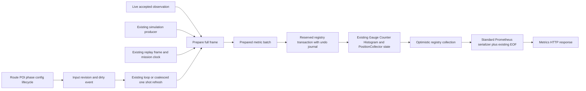
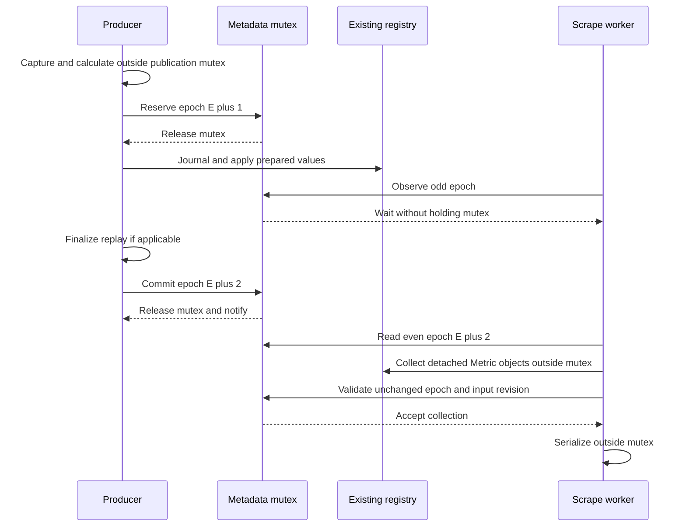

# Read only metrics scraping and producer publication

Status: proposed written specification for #391, awaiting separate approval. The
architecture was approved on 2026-10-21; this document and its companion
implementation plan are not implementation authorization. No application changes
are included in the documentation branch at this stage.

The
[ownership and acceptance contract](2026-10-21-perf-391-metrics-publication-contracts.md)
is part of this specification and must be reviewed with it.

## Purpose and boundaries

Make `/metrics` serialize already published metrics without constructing a
simulator, advancing a source, calculating ETA, accessing mission or POI
storage, or changing business state. Preserve metric contracts, genuine
preflight estimates, source provenance, replay clocks, and operational
functionality.

The existing Python Prometheus registry remains the only authoritative metric
store. A scrape snapshot is a temporary collection result from that registry,
not a second producer-maintained store. No exposition byte cache, replacement
metric implementation, new periodic worker, or external infrastructure is added.

Publication synchronization must not perform domain calculations, filesystem
operations, registry collection, or exposition serialization while holding the
publication mutex. The normal client library's internal scalar locks remain its
implementation detail. This specification distinguishes a logical write
reservation from a held mutex.

General stale-label/cardinality repair, including the existing
`mission_active_info` empty-route child bug, remains #393. Only invalidation of
the immediately superseded active frame and removal of never-committed label
children during rollback belong to #391. Do not change ETA algorithms, mission
lookup caching, history cadence, transport modeling, evidence recording, or UI.
Do not deploy, merge, or close #391 without separate authorization.

## Components and data flow

`PublicationCoordinator` owns generation metadata and write admission for one
registry. `PreparedMetricBatch` holds temporary, validated operations and input
identity. A temporary undo journal exists only during an admitted write.
`CapturedRegistry` holds the detached client `Metric` objects for one request
and implements only `collect()` for the existing serializer. It is not an
exporter or independently updated metric store.

`MetricsRefreshOwner` connects successful lifecycle mutations to producer work.
It keeps one dirty flag/reason set, not an event queue or a second telemetry
cache. The existing coordinator remains the observation owner. Only an admitted
producer may use a copied last observation to derive metrics.

## Atomic registry publication

### Registry and client compatibility

Keep `REGISTRY` a standard `CollectorRegistry`, keep the existing metric objects
and import shims, and retain all names, types, labels, units, buckets, created
timestamps, and counter meanings. `PositionCollector` continues to read
`_current_position`; those three values participate in the same transaction as
the corresponding scalar position gauges. It does not query the coordinator.

The registry's own lock protects collector registration, not a complete
cross-family frame. Gauge locks also cannot prevent a position from generation N
being collected beside an ETA from N+1. This is the demonstrated need for the
publication protocol below. It does not justify replacing the serializer.

The transaction adapter supports the types actually registered here: Gauge,
Counter, Histogram, and PositionCollector. Rollback needs narrowly isolated
client internals: scalar `_value`, histogram `_sum` and `_buckets`, exemplars,
and labeled-parent `_metrics` membership. Preserve `_created` for existing
children; remove children first created by an aborted transaction. Do not copy
all historical label children, rebuild the registry, unregister collectors, or
change existing references. Normal writes still use public client operations.
This adapter targets the existing single-process value implementation; callback
gauges and multiprocess/mmap values are unsupported and rejected by shape
checks. Supporting them would need separate design review, not hidden
scrape-time I/O.

Validate supported shapes at startup and in tests against the declared
`prometheus-client>=0.19.0` floor and deployed version. The locally inspected
0.26.0 client exposes these shapes; that inspection is not proof for all
versions. Do not silently pin or raise the requirement. A failed compatibility
check disables successful metrics exposition with a diagnostic; it must not
fabricate data or terminate unrelated application functionality. Release is
blocked until compatibility is proven. A custom test registry gets its own
coordinator and position store; unsupported mutable custom collectors require an
explicit adapter and renewed design review. Collector registration is sealed
after initialization; ordinary label-child creation remains supported. Sealing
records the allowed collector identities and rejects capture if they change; it
does not monkeypatch the standard registry registration API.

### Write protocol and linearization

Metadata consists of an unbounded integer `epoch` (even when quiescent),
`pending_writer`, `input_revision`, `committed_input_revision`, readiness, and
failure state. Every registry mutation in the audited application uses this
coordinator, including compatibility update functions and error counters.

1. Capture detached source/config/route/POI/phase inputs through the existing
   repository admission gate. Domain calculations and flight-state operations
   occur outside the publication mutex. Prepare and validate every metric
   operation, labels, and non-finite policy before reserving a write.
   Preparation must not create registry label children or change
   gauges/counters.
2. Re-enter existing repository admission to validate the input revision and
   replay/source identity. Keep that existing gate through the short registry
   transaction so input mutation cannot race finalization. It may cover scalar
   assignments and replay finalization, but no route traversal or storage read
   is added to this commit section.
3. Under the publication mutex, verify no pending writer and the expected input
   revision, reserve the writer, and change even epoch E to odd E+1. Release the
   mutex immediately. A competing writer waits on the condition with the mutex
   released, then revalidates; it never writes into another reservation.
4. While holding the logical reservation, but **not** the publication mutex,
   capture an undo journal of touched scalar values, exemplars, affected parent
   membership, and the position dictionary. Apply the prepared public client
   operations. Domain calculations, I/O, or exposition are not callbacks of this
   operation. New children are hidden from successful readers by the odd epoch.
   Cumulative histogram-bucket conversion occurs only during collection, outside
   the mutex.
5. For replay, finalize the associated prepared runtime tick before making the
   epoch even. The existing repository gate excludes competing replay/config
   transitions. Save a temporary in-memory replay checkpoint so exceptions from
   finalization can restore runtime, flight, coordinator, and registry together.
   No mission files are written in this publication section.
6. Under the publication mutex, publish the committed input revision and source
   identity, update readiness/failure metadata, clear the reservation, and set
   epoch E+2. This even-epoch transition is the linearization point. Notify
   waiting readers/writers; release the mutex. Discard the journal.

Reservation ownership uses `try/finally`: cancellation or another escaping
exception restores the journal and notifies waiters before it propagates. The
existing shield-and-drain behavior must keep worker ownership through cleanup.

No await, arbitrary callback, domain computation, file operation, registry
collection, or text generation occurs while the publication mutex is held. An
odd epoch is a reservation marker, not a held lock. The existing repository gate
is acquired before publication admission; publication code never acquires
repository, flight-state, or manager locks while holding its mutex.

### Read protocol

Run capture and serialization in the existing threadpool. Read the even epoch,
input/committed revision, readiness, and failure status under the tiny mutex.
Call `tuple(REGISTRY.collect())` outside that mutex. Each supported collector
produces detached `Metric`/sample objects; retain no mutable sample-label
aliases to the live registry. Recheck metadata under the mutex. Accept only an
unchanged even epoch with matching input revisions, ready state, and no failure.
If a write begins just after validation, the detached result still represents
the previous complete generation, which is valid.

Attempt at most three collections, with condition waits sharing a total
50-millisecond contention deadline; waits release the mutex. This bounds retry
work, not the serializer's runtime. Exhaustion, unrecovered failure, or pending
lifecycle invalidation returns HTTP 503 with no metric body. Never return an
unvalidated collection or switch to raw `generate_latest(REGISTRY)` as fallback.
The normal and exception-fallback paths use the same capture protocol.

Feed accepted samples to the existing `prometheus_client.generate_latest`
encoder; retain the current content type and single trailing `# EOF\n`. Do not
introduce a different OpenMetrics encoder as an incidental contract migration.
Keep `_prepare_metrics(route_manager=None, poi_manager=None)` and asynchronous
`get_metrics(...)` callable for compatibility and the frozen probe; old manager
arguments are ignored and are no longer FastAPI dependencies.

The `/position-table` compatibility endpoint uses a bounded, validated
three-value capture of the same position store; it must not read the dictionary
across an in-progress write. No table schema change or extra producer is added.

The epoch covers all participating writers, so one successful HTTP response
cannot straddle two publication generations. Independently produced GEP and
service metadata may have distinct observation times within that generation;
this protocol does not invent a single acquisition time for independent sources.

The consistency argument requires all writers to participate: a write marks the
epoch odd before touching a value and advances it monotonically on completion or
abort. If capture sees the same even epoch before and after collection, no write
overlapped that collection. A write after validation cannot mutate its detached
samples. Input-revision and failure checks reject an obsolete source frame even
when no numeric gauge changed. There is no epoch reuse or wraparound. Reader
code never acquires repository admission, so it cannot create a lock-order cycle
with a producer waiting to finalize. Tests must exercise these premises,
including cancellation, rather than asserting safety from a low retry count.

## Failure and recovery

| Condition                                     | Registry and HTTP behavior                                                                                                                                                  | Recovery                                                                                                                                    |
| --------------------------------------------- | --------------------------------------------------------------------------------------------------------------------------------------------------------------------------- | ------------------------------------------------------------------------------------------------------------------------------------------- |
| Input revision changes during preparation     | Discard prepared batch; no gauge/counter mutation; dirty revision cannot be served as current                                                                               | Existing producer or coalesced refresh recaptures inputs                                                                                    |
| Preparation/ETA error                         | Preserve last committed registry values and successful-update time; set full-frame failure state; `/metrics` returns 503                                                    | Next successful full refresh, including explicit all-unavailable frame, clears failure                                                      |
| Client write or replay-finalization exception | Keep epoch odd; restore journal and replay/flight/coordinator checkpoints outside publication mutex; then finish even with failure state; never expose intermediate samples | Count producer error through an admitted metadata transaction; retry full refresh through existing owner                                    |
| Undo restoration itself fails                 | Quarantine registry, leave successful exposition disabled; no raw fallback, counter reset, or partial recovery scrape                                                       | Retain journal until restoration succeeds; attempt restoration before next full refresh; otherwise restart is required and acceptance fails |
| Ordinary disconnect or missing source         | This is not a publication failure: atomically publish existing NaN telemetry clears plus valid route/phase/planned state                                                    | Next accepted observation restores available values                                                                                         |
| Writer contention or repeated read conflict   | Bounded reader retries, then 503; no unbounded spin or mutex held while waiting                                                                                             | A subsequent scrape reads a completed generation                                                                                            |
| Serialization fails                           | Do not mutate registry; fallback may recapture using the same protocol; if it still fails, return 503                                                                       | Next scrape; diagnostic outside registry transaction                                                                                        |

Every failure marks metadata before a reader can validate the old epoch.
Successful smaller transactions cannot erase full-frame failure. A caller must
never use a fresh scrape timestamp to claim an old acquisition is new. HTTP 503
is an explicit new failure behavior for unrecovered publication faults or
exhausted contention, replacing unsafe raw-registry fallback. Normal successful
HTTP schema/content remains unchanged; health keeps its existing scrape-attempt
tracking. No new public metric family or required user acknowledgment is added.

Invalidate only the previously active frame's affected route/POI label children
to NaN when their meaning is superseded, including an ETA mode-label change.
Retain unrelated historical children and all monotonic totals. Restoring
never-committed label membership after a failed write is transaction rollback,
not the general cardinality cleanup in #393.

## Internal interfaces and dependencies

New internal module `app/core/metrics/publication.py` defines
`MetricInputIdentity`, `PreparedMetricBatch`, `PublicationCoordinator`,
`CapturedRegistry`, `PublicationUnavailable`, and the supported-client undo
adapter. `PublicationCoordinator.commit(batch, finalize=None, rollback=None)`
admits a prepared batch; optional replay hooks must be in-memory operations.
`capture(max_attempts=3, contention_timeout_seconds=0.05)` returns a detached
single-generation `CapturedRegistry` or raises `PublicationUnavailable`.

`app/core/metrics/frame_builder.py` prepares full/derived/unavailable batches
from detached inputs. It does not update registry state. Existing public
`update_metrics_from_telemetry`, clear helpers, mission helpers, service-info
helpers, and import shims remain callable; they prepare and commit through the
same coordinator. Internal replay preparation returns a batch for finalization
by the replay owner instead of committing ahead of the runtime tick.

`app/core/metrics/lifecycle.py` defines `MetricsRefreshOwner`,
`mark_dirty(reason)`, `refresh_without_collection()`, and `close()`. Manager
callbacks are optional dependencies registered during lifespan and unregistered
on shutdown; tests can attach a recorder. Internal ETA service gains explicit
accepted-sample versus read-only derivation entry points. The implementation
plan pins their signatures. No external API schema, dependency manifest,
Prometheus configuration, deployment configuration, polling interval, or new
service is required. #390 kickoff is the only prerequisite; #392/#393 are not
dependencies.

## Review status

This specification and the
[implementation plan](../plans/2026-10-21-perf-391-metrics-publication.md) need
separate explicit approval before implementation. Review must include the
optimistic-reader/undo-adapter tradeoff, the bounded 503 behavior, and the
lifecycle one-shot path. No application code, deployment, merge, or issue
closure is authorized by writing these documents.
