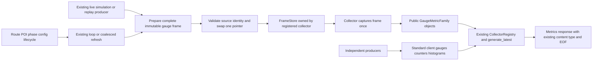
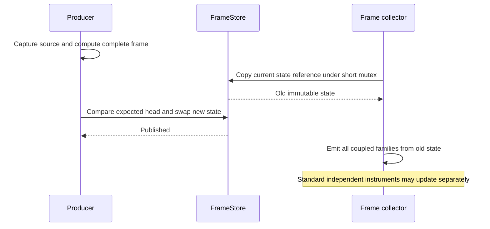

# Producer owned gauge snapshots and read only scraping

Status: revised proposal responding to the
[PR #403 review](https://github.com/bcl1713/starlink-dashboard/pull/403#issuecomment-6304866293).
The written specification and implementation plan remain unapproved. No
application implementation is included. This version supersedes the global
epoch, undo-journal, and replay-checkpoint design in commit `988d8c78`.

Read this with the required
[ownership and acceptance contract](2026-10-21-perf-391-metrics-publication-contracts.md),
[architecture decision](2026-10-21-perf-391-metrics-publication-decision.md),
and [implementation plan](../plans/2026-10-21-perf-391-metrics-publication.md).

## Purpose and selected boundary

The primary objective of #391 is zero simulator construction, ETA calculation,
mission/POI lookup, source advancement, or storage writes during `/metrics`.
Preserve source provenance, genuine preflight estimates, replay clocks, metric
schemas, standard cumulative instruments, and operational functionality.

Publish the coupled dynamic gauges through one immutable snapshot owned by one
collector registered in the existing `CollectorRegistry`. Keep independent
measurements in ordinary client Gauge, Counter, and Histogram objects. Use the
standard Prometheus serializer. There is no global transaction, client-private
undo adapter, scrape retry protocol, byte cache, or new periodic worker.

**Consistency is scoped:** all coupled aircraft/ETA/route/mode gauges and the
custom position alias in one scrape come from one snapshot. Independent GEP,
mission planning instruments, counters and histograms keep their own sources and
update times. A scrape is not a transaction over unrelated measurements. This
deliberately replaces the earlier, stronger whole-registry invariant; no
consumer may treat a cumulative histogram or planned mission value as a
same-acquisition aircraft observation. The ownership contract lists every family
and explains the independent mission/replay boundary.

## Components and data flow

`GaugeFrame` consists of frozen family/sample records, normalized string label
values, numeric values, and source identity. It contains no client Gauge
objects, mutable sample dictionaries, callbacks, manager references, or history
of prior generations. Build it completely before publication. Never retain the
expected head or a parent-frame link inside a committed frame; release the
producer-local expected reference after commit/discard.

`PublicationState` holds that frame plus its input revision and ready/pending/
failed status. `FrameStore` owns one current state. `TelemetryFrameCollector`
reads it once per `collect()` and creates all coupled `GaugeMetricFamily`
objects from that captured state. These are normal public client collector
objects, not a custom text encoder.

## Authority and compatibility

The registered collector's snapshot is the **only numeric state** for its
coupled families. The existing registry is still the canonical collection and
exposition API; the collector owns its backing state just as PositionCollector
currently owns a view of `_current_position`. Do not retain mutable client Gauge
copies of these same values or separately update an exposition cache.
Independent metric objects remain registered and authoritative as before.

The coupled definitions become frame-backed handles, declared once with the
existing name, help text and label schema. Preserve import names and identities
across `app.core.metrics` and its legacy shim. A handle supports the operations
used by the repository: `labels(*values, **labels)`, `set(value)` during
producer frame preparation, and `collect()` for reading its family. Label
binding creates only an immutable view; it does not create a registered child or
publish zero. Within a preparation context, `set` writes temporary builder data;
successful completion seals and publishes the whole frame. A failed builder
publishes nothing. No individual coupled setter may patch the live frame.

This has an explicit internal compatibility cost: these handles are not
`prometheus_client.Gauge` instances, have no `_value` or `_metrics` storage, and
reject direct writes outside a producer preparation context. They are not a
general Gauge emulation; callback gauges, arbitrary `set_function`, or
unsupported mutation methods are not silently accepted. Named updater, clear,
service-info and mission-helper signatures remain supported. Migrate all actual
coupled write sites and private test fixtures; retain the existing Counter and
Histogram class identities and behavior. If an additional operational caller
requires broader raw Gauge compatibility, stop for review rather than adding a
large proxy or a second numeric store.

Keep the public PositionCollector output `starlink_aircraft_position` with its
three `dimension` values. The full frame collector emits that alias from its
already captured frame; it must not call a separate collector that recaptures
the pointer. A standalone PositionCollector compatibility view may read one
frame. `_current_position` becomes a read-only mapping over the same state, not
a second dictionary. `/position-table` captures once for its three values and
keeps its existing response schema. Direct fixture writes to the old dictionary
must move to an explicit frame reset fixture.

## Publication and read algorithm

1. Capture detached source/config/route/POI/phase inputs under existing
   repository admission. Calculate and validate the entire frame outside the
   publication mutex. Preserve the original observation timestamps and replay
   context. Normal accepted updates and refresh-only work are distinct paths.
2. Revalidate source identity under existing repository admission. Before the
   swap, reject a stale route/config/observation/run identity or superseded
   publication state. Existing authoritative filesystem checks stay in producer
   admission, never in collection. A process-local revision is invalidation
   metadata, not a mission cache.
3. Acquire the short FrameStore mutex, compare the expected immutable head,
   replace it with the fully prepared state, and release. The pointer swap is
   the only commit point. A losing producer discards its temporary frame and
   lets the existing owner coalesce a refresh; it does not recollect telemetry
   or re-observe counters/histograms. Each committed head is a fresh object.
4. On collection, acquire the mutex only to retain one state reference, then
   release it. Iterate frozen samples and construct standard metric families
   outside the mutex. Keep that reference until all coupled families are
   emitted. Existing `generate_latest(REGISTRY)` then serializes them alongside
   independent instruments. No validation retry or contention 503 is needed.

No calculation, file operation, family construction, collection traversal, text
generation, or wait occurs inside the pointer mutex. Repository admission
precedes publication; a reader never acquires repository/manager locks. This
provides a simple argument: a reader owns either the old immutable frame or the
new one, and later swaps cannot mutate either frame's values or dynamic labels.
There is no epoch to wrap, journal to restore, or callback to run in a commit.

Keep asynchronous `get_metrics(...)` and
`_prepare_metrics(route_manager=None, poi_manager=None)` callable for the frozen
issue #390 probe. Old manager arguments are ignored, and FastAPI no longer
resolves them. Execute exposition in the existing threadpool. Normal and
fallback paths both collect the registered snapshot collector; never construct a
simulator or regenerate a frame. Retain the existing encoder, content type and
exactly one trailing `# EOF\n`.

## Failure, health, and recovery

| Event                                                   | Required behavior                                                                                                                                                                                                                                                                                                |
| ------------------------------------------------------- | ---------------------------------------------------------------------------------------------------------------------------------------------------------------------------------------------------------------------------------------------------------------------------------------------------------------- |
| Input invalidation during preparation                   | Mark the state pending and schedule refresh; reject an obsolete prepared head. Render affected coupled values unavailable while the new input is pending.                                                                                                                                                        |
| Builder exception or cancellation                       | Discard all temporary values and label bindings; retain the last committed frame internally but mark publication failed. Render unavailable values rather than silently serving its old observations as fresh.                                                                                                   |
| Known missing/optional ETA input                        | Build a complete frame with valid observed fields and explicit NaN for uncomputable ETA/distance. Ordinary missing data is not a half-committed frame.                                                                                                                                                           |
| Ordinary disconnect                                     | Publish a complete unavailable-observation frame plus valid route/phase/planned state. Preserve original last-successful-observation time.                                                                                                                                                                       |
| Recovery                                                | Existing next tick, dirty wake, or disabled-background one-shot prepares a complete valid or explicitly unavailable frame and swaps out the failure state. No retry worker is added.                                                                                                                             |
| Pointer contention                                      | Only brief reference operations contend. A superseded producer is rejected, not rolled back; scrapes never retry the whole registry.                                                                                                                                                                             |
| Unexpected collector/serializer or registration failure | Return 503 rather than partial/malformed text, record diagnostics, and report degraded health. Keep unrelated application functionality available; registration faults need controlled reinitialization/restart, while transient serialization faults can recover on the next scrape; no quarantine restoration. |

Pending/failed masking uses the captured immutable state: construct NaN samples
for observation-dependent families and affected input-dependent fields outside
the mutex. Keep the last successful observation/publication timestamp as its old
known value; never renew it on a failed or derived-only refresh. Retain
independent instruments and their existing cumulative values. Expected source
unavailability can therefore return valid HTTP 200 with truthful NaN gaps; there
is no new global 3-attempt/50-ms 503 policy.

Health retains `prometheus_last_scrape` as attempt time and adds a bounded
`metrics_publication` diagnostic with state and reason. Top-level `status` is
`degraded` for failed/uninitialized publication or exposition failure, even when
scrape attempts are recent. A successfully published ordinary unavailable source
frame is not a publisher failure. Do not add these diagnostics to the customer
Overview or invent new Prometheus families. Health recovery follows a successful
complete publication/exposition, not merely another request.

A failed stale preparation may mark failure only if its expected head still
matches; it cannot mask a newer successful publication. Automatic recovery uses
the existing background deadline. With background tasks disabled, recovery needs
another explicit refresh event; no retry timer or registration-on-scrape is
added.

Independent Counter/Histogram operations are neither rolled back nor replayed on
snapshot failure. Observe each admitted telemetry sample once through its
existing producer, with the original labels and availability checks. A
refresh-only retry adds no counts, histogram observations or created children.
Client label initialization, buckets/sum/count, exemplars and `_created` retain
standard semantics. No #391 code accesses or restores their private internals.

## Replay and lifecycle scope

Preserve existing runtime/flight/coordinator error handling and repository
admission. Prepare the gauge frame during the existing replay publish callback,
but delay its pointer swap until `commit_tick` has returned successfully inside
the existing gate. Apply the same ordering to initial leg activation. On an
existing error path, discard the prepared frame and expose failed/unavailable
publication. Do not add runtime checkpoints, a replay transaction framework, or
rollback of independent mission counters/gauges. This changes publication
ordering, not the mission clock or business transaction model.

The ownership contract retains the exact lifecycle trigger matrix, one-shot
behavior for disabled backgrounds, source identity rules, preflight fallback,
and no-speed/unknown behavior. Notifications are bounded invalidation metadata;
the existing update loop performs the work without moving its collection
deadline or advancing a source on a dirty wake.

## Dependencies and review gate

Use only public collector/registry/serializer APIs available at the declared
client minimum 0.19.0; run the probe and future integration tests at that
minimum and the deployed version. There is no private-layout support matrix or
new manifest pin. Custom callback collectors remain explicitly independent and
must be read-only; they are not claimed to be immutable frame members. No
callback/custom source runs under the FrameStore mutex.

Issue #390 kickoff is the prerequisite; #392 and #393 are not dependencies.
General label cleanup and the known `mission_active_info` bug remain #393. Limit
frame invalidation to directly superseded active inputs and abandoned staged
children; do not sweep independent client labels or prune mission data.

The isolated probe establishes feasibility, not application acceptance. The plan
has a stop/go checkpoint after schema, import-compatibility and concurrency
tests and before production replay/lifecycle edits. Both written artifacts still
need approval. Do not implement, deploy, merge PR #403, or close #391.
